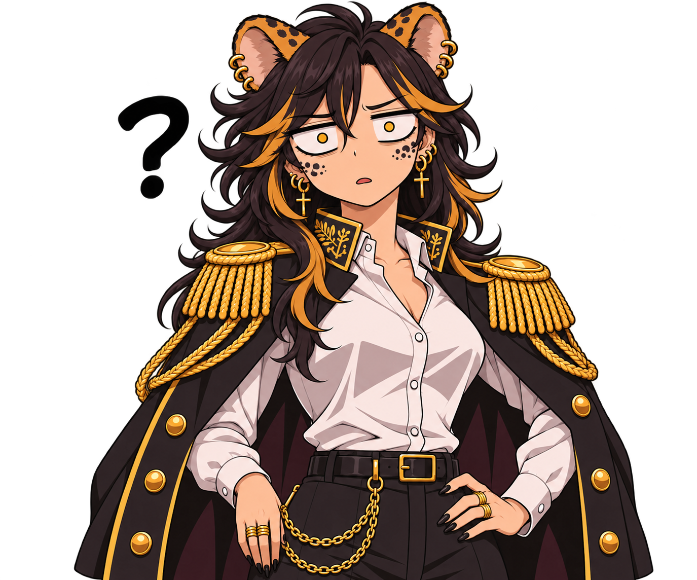
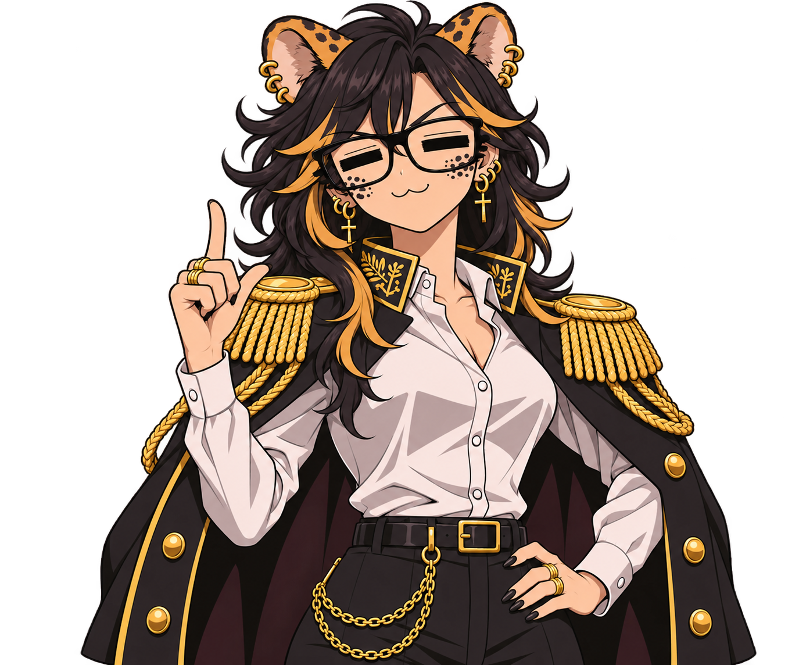
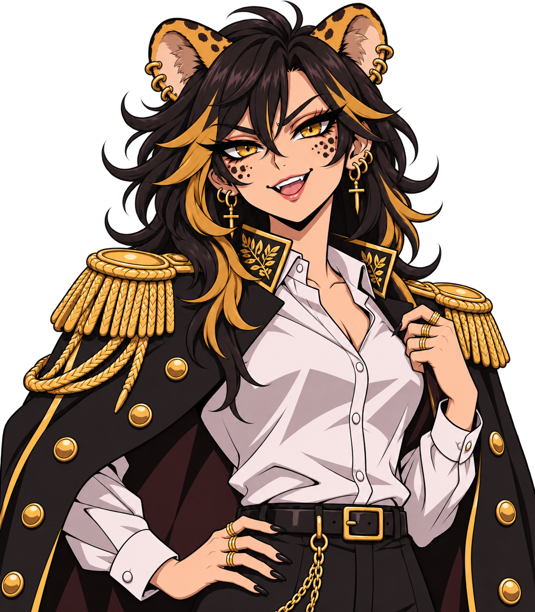
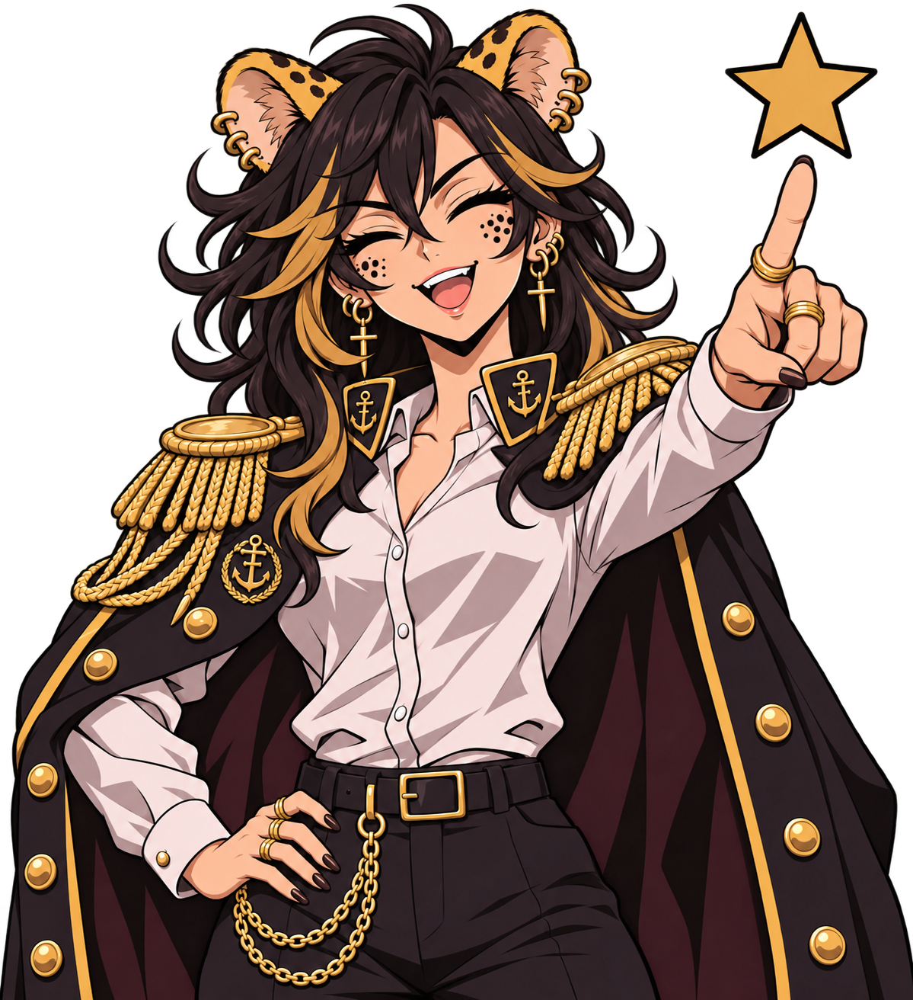
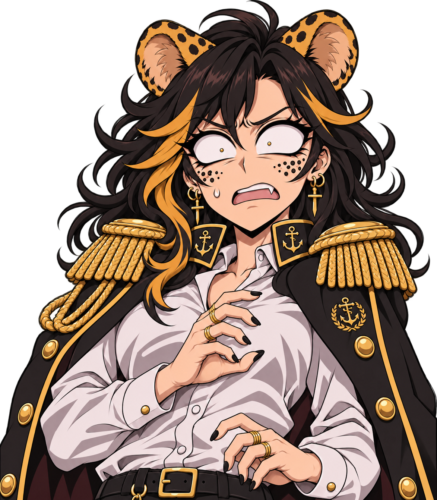
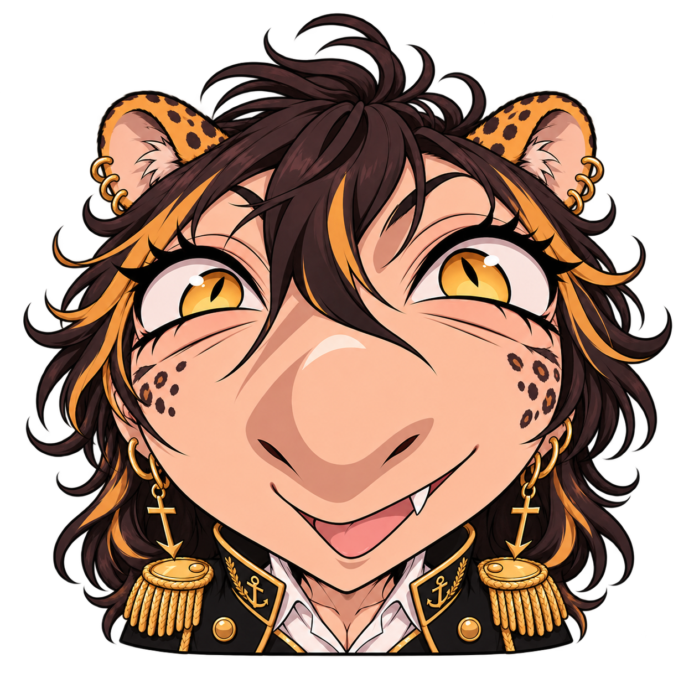

# Маскот для фронтенда

Шесть оригинальных PNG, предоставленных участником команды 13 ноября 2026 года. Файлы скопированы без изменения изображения: прозрачность и исходное разрешение сохранены. Это статичные состояния, не готовые кадры покадровой анимации и не Live2D-модель. Папка не подключает маскота к карте автоматически.

## Состояния по указанию автора

Нумерация соответствует исходным именам файлов, а не порядку вложений в чате. В частности, исходный `5.png` — удивление, `6.png` — первый визит.

| Исходник | Файл | Состояние | Когда показывать | Пример реплики |
|---|---|---|---|---|
| 1.png | [location-unknown.png](location-unknown.png) | Не знает, где человек находится или какое место имеется в виду | Старт не выбран, GPS недоступен или место не распознано | «Пока не понимаю, где ты. Выбери точку на карте или разреши геолокацию» |
| 2.png | [interesting-places.png](interesting-places.png) | Рассказывает об интересных местах | История места, подборка достопримечательностей, факт квеста | «Хочешь узнать, чем интересно это место?» |
| 3.png | [talking.png](talking.png) | Просто рассказывает или подсказывает | Обычная подсказка, объяснение интерфейса, нейтральный ответ | «Выбери прогулку — покажу её остановки» |
| 4.png | [directions.png](directions.png) | Указывает, куда идти | Выбрана следующая остановка, есть кнопка открытия 2ГИС | «Следующая остановка выбрана. Откроем путь в 2ГИС?» |
| 5.png | [surprised.png](surprised.png) | Удивляется быстрому приходу или реагирует на проблему | Пользователь сообщает о прибытии либо обращается с проблемой | «Уже здесь? Вот это темп!» / «Что случилось? Попробуем разобраться» |
| 6.png | [first-visit.png](first-visit.png) | Реагирует на кнопку «Я тут впервые» | Первое знакомство и выбор интересов | «Впервые во Владике? Давай найдём, с чего начать!» |

Реплики — предлагаемые тексты, а не встроенная логика. Не обещать распознанное прибытие или измеренную скорость: в текущем P0 этого нет. Удивление по прибытии допустимо после явной отметки пользователя. Состояние directions не означает встроенную пошаговую навигацию; путь строится во внешнем 2ГИС. Для ошибки или проблемы не использовать шутку про скорость.

## Быстрый просмотр

| Нет местоположения | Интересные места | Подсказка |
|---|---|---|
|  |  |  |

| Куда идти | Удивление или проблема | Я тут впервые |
|---|---|---|
|  |  |  |

## Подключение

Рядом находится [manifest.json](manifest.json) с ID, относительными путями, исходной нумерацией и размерами. Пути считаются относительно папки манифеста, это не абсолютные URL сайта.

Для Vite фронтендер может скопировать файлы в `frontend/public/mascot/` и использовать `/mascot/talking.png` с учётом настроенного base URL. Другой вариант — импортировать изображения через сборщик. Не ссылаться из интерфейса на локальные Windows-пути или GitHub blob URL. Определить размещение при подключении к реальной структуре фронтенда.

Изображения имеют разные пропорции, поэтому контейнер должен сохранять размеры между сменами состояний: фиксированная область, `object-fit: contain`, `object-position: center bottom`. Не растягивать рисунок и не обрезать уши или указующую руку. Крупный план first-visit намеренно отличается от остальных; для него можно предусмотреть отдельный приветственный экран.

Все шесть оригиналов вместе занимают около 11 МБ. Не загружать их все до первого отображения карты. При интеграции можно подготовить более лёгкие WebP/AVIF-копии с прозрачностью, сохранив эти оригиналы; перед использованием проверить контуры на светлом и тёмном фоне. Оптимизированные копии в этот набор не входят.

## Предлагаемая анимация появления

Это задание фронтендеру, а не уже реализованная анимация:

1. По нажатию на кнопку персонаж появляется из нижнего края панели: прозрачность 0 → 1, сдвиг вниз 24 px → 0, масштаб 0.94 → 1. Небольшой отскок, общая длительность около 400–500 мс.
2. Через 100–150 мс после начала появляется облачко с репликой. Текст доступен сразу; посимвольная печать необязательна.
3. При смене состояния — короткое затухание/появление за 150–200 мс без прыжка размеров. Не выдавать смену изображений за движение рта.
4. Лёгкое покачивание целого рисунка допустимо после появления, но не обязательно. Голова, волосы и глаза не отделены слоями; независимая анимация этих частей требует отдельной подготовки.
5. При `prefers-reduced-motion: reduce` убрать перемещение, масштаб и покачивание. Оставить статичный переход либо короткое изменение прозрачности.

На телефоне персонаж показывается в сворачиваемой панели, не перекрывает кнопки карты и атрибуцию. У панели есть доступная кнопка закрытия. Если текст рядом полностью передаёт смысл, изображение декоративное (`alt=""`); если оно передаёт отдельную информацию — нужен соответствующий alt. Не отправлять каждую смену позы в экранный диктор.

## Граница работы

Добавлены только предоставленные изображения, описание и манифест. Карта, свободный чат, API, геолокация, анимации и автоматическое распознавание эмоций этим изменением не реализуются. Отдельной лицензии на переиспользование изображений вне проекта не задано.

## Полный набор реплик

[Готовые тексты для всех ситуаций](../../docs/MASCOT_DIALOGUE.txt): привязка к изображениям, прогулки, исторические справки, квесты, завершение, ошибки и правила характера. Подключать только реплики, соответствующие фактически реализованному событию.
