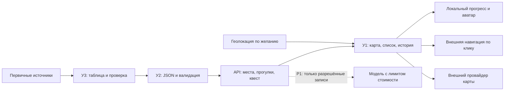

# Архитектура демо на 36 часов

Это проектное решение для будущей реализации. Основной клиент, сервер и инфраструктура ещё не созданы; отдельно подготовлен [пример карты Ленинского района](MAP_LENINSKY.md) на Leaflet 1.9.4 с OSM-границей и стартовыми кандидатами. Стек основного приложения подтверждаем на H0: если оба разработчика лучше знают другой стек, выбираем знакомый эквивалент и сохраняем контракт и объём. Не изучаем новый большой фреймворк в середине вайбатона.

География первой версии фиксирована: только Ленинский район Владивостока, с компактным участком для первых 8 мест и прогулок. На старте карты и в ручном выборе используем проверенные точки этого района. Каталог проверяется редактором; динамическое переключение районов и серверный геопоиск не добавляем. Радиус не расширяет районную базу.

| Часть | Решение P0 | Ответственный |
|---|---|---|
| Клиент | React + TypeScript + Vite, один адаптивный каркас и общие панели | У1 |
| Сервер | FastAPI, JSON API, валидация и ограничения | У2 |
| Данные | Редактируемые JSON-наборы в Git; загрузка в память, без БД и публичной записи | У2 импортирует, У3 проверяет содержание |
| Карта | Leaflet, маркеры; провайдер тайлов согласовать и проверить рано | У1, У2 помогает с размещением |
| Навигация | Внешний сервис по координатам проверенного места, фиксированный разрешённый URL | У1 |
| Геолокация | Одноразовый запрос по кнопке, только память браузера; радиус/расстояние по прямой локально | У1 |
| Прогресс и аватар | Версионированный localStorage: выбранный значок, пройденные точки, 1 шапка, сброс | У1 |
| Размещение | Предпочтительно один origin: собранный клиент и `/api/v1` за одним HTTPS-адресом | У2, У1 готовит сборку |

React описывает [вариант с Vite](https://react.dev/learn/build-a-react-app-from-scratch), FastAPI — [OpenAPI и документацию API](https://fastapi.tiangolo.com/tutorial/first-steps/). [Leaflet](https://leafletjs.com/examples/quick-start/) предоставляет маркеры и линии; при реализации выбираем проверенный стабильный релиз и используем документацию именно его версии. Не переносим beta-пример вслепую. Версии фиксируем lock-файлом/проверенным списком зависимостей, пакет сверяем с официальным проектом.

## Данные и запросы



Клиент получает каталог целиком: 8–10 записей не требуют геопоиска на сервере. Сервер фильтрует по известным интересам/потребности/бюджету, клиент дополнительно считает радиус от выбранного старта. Координаты посетителя не нужны в API. Политика приватности должна учитывать, что внешний провайдер карты видит сетевые запросы тайлов и область просмотра; внешняя навигация открывается только после клика, ей передаём координаты цели, не автоматическую историю посетителя.

Геолокация браузера требует разрешения и защищённого контекста: для размещённого демо используем HTTPS; [MDN Geolocation](https://developer.mozilla.org/en-US/docs/Web/API/Geolocation_API). Отказ, ошибка и таймаут ведут к ручному старту. Не включаем постоянное отслеживание, не пишем GPS в localStorage/URL/логи.

Клиент интегрирует одноразовое определение позиции, её точность, маркер «Вы здесь», сортировку по расстоянию и обновление по кнопке. Геолокация и расчёт «рядом» не зависят от тайлов карты; при их сбое работают в списке. Состояния, защита от устаревших ответов и критерии приёмки — [GEOLOCATION.md](GEOLOCATION.md).

## Карта и маршруты

Тайлы — отдельный внешний ресурс, не часть Leaflet. Для небольшого прототипа можно рассмотреть стандартные OSM-тайлы при соблюдении [Tile Usage Policy](https://operations.osmfoundation.org/policies/tiles/): видимая атрибуция, обычное браузерное кеширование и Referer, без массовой выгрузки/предзагрузки. У сервиса нет гарантированного SLA; провайдера можно сменить конфигурацией. Не ставить политику referrer, которая ломает требования тайлов; согласовать её с настройками безопасности.

Проверяем тайлы из сети, где будет демонстрация, до H8. Сбой тайлов не мешает списку, карточке и открытию внешнего навигатора. Если карта окончательно не работает, честно показываем сокращённый вариант списком; полный P0 с картой не считаем выполненным.

Прогулка — упорядоченные ID мест, а не граф дорожной сети. Прямая линия служит схемой порядка. Реальный пешеходный проход проверяет У3, внешний навигатор строит путь к следующей точке. Замена точки — только P1 и не обещает пересчёт проходимости/длительности. Фильтр «компания/пара» в полном видении требует проверки условий, P0 его не обещает.

## Будущие файлы и владельцы

```text
frontend/             У1: UI, API client, map, local progress, package.json и client lockfile
backend/              У2: API, schemas, validation, limits, dependencies
data/                 У3 содержание; У2 валидирует и импортирует JSON
docs/API.md           У2; изменения согласует с У1 до кода
docs/                 У3 актуализирует задачи/контент, технические решения — с У2
root deployment       У2; общий конфиг меняется по договорённости
```

Сейчас в `data/` есть правила сбора и отдельный `geo/` со слоями OSM; три точки в нём — draft-кандидаты, не проверенный каталог API. `frontend/` и `backend/` создадут разработчики. До H2 добавить общие фикстуры/примеры API; синтетические записи маркировать `demo` и не выдавать как реальные. Исходная Word-задумка и личные пути участников не нужны в публичном репозитории.

## Минимальные проверки при реализации

У2: импорт и связи ID, verified/срок, неизвестная цена под «бесплатно», неверные параметры, неизвестные ID/варианты ответа, размер/частота запроса и безопасные ошибки. У1: один полный путь, отказ GPS, пустой радиус, сбой карты/API, сохранение и сброс прогресса, отсутствие ключей в клиенте. У3: источники, условия, проход, приёмка и защита. Команды добавлять вместе с настоящим кодом; сейчас тестов приложения нет. Полный допуск — [RELEASE_CHECKLIST.md](RELEASE_CHECKLIST.md).
