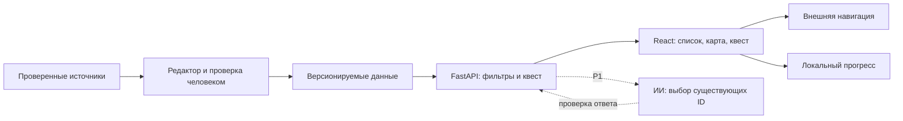

# Предлагаемая архитектура

Это проектное решение для обсуждения, а не уже реализованная система. Если команда уверенно владеет другим стеком, лучше сохранить знакомые инструменты и согласованный API.

| Часть | Предложение | Причина |
|---|---|---|
| Интерфейс | React + TypeScript + Vite, мобильная адаптация | Один веб-клиент для телефона и ноутбука, типизированные модели |
| Сервер | Python + FastAPI | Небольшой JSON API и документирование схем |
| Данные MVP | Проверенные JSON-файлы, загружаемые сервером | Для 15 мест не нужна отдельная админ-панель или сложная БД |
| Карта | Компонент с маркерами; провайдер выбирается до реализации | Список остаётся доступен при сбое карты; заранее проверить условия, атрибуцию и квоты |
| Навигация | Внешний картографический сервис | Маршруты и транспорт рассчитывает внешний сервис |
| Прогресс квеста | localStorage на устройстве | Работа без регистрации; прогресс можно сбросить |
| Runtime ИИ, P1 | Только серверный вызов выбранного провайдера | Ключ остаётся на сервере; каталог и квест не зависят от модели |

React описывает [создание приложения с Vite](https://react.dev/learn/build-a-react-app-from-scratch); Vite предлагает [шаблон react-ts](https://vite.dev/guide/). FastAPI документирует [OpenAPI и интерактивную документацию](https://fastapi.tiangolo.com/tutorial/first-steps/). Это основание технического предложения; версии зависимостей и требования среды нужно закрепить при создании кода, затем коммитить lock-файлы. Для более крупного продукта архитектуру пересмотреть.

## Поток данных



## Будущая структура кода

```text
frontend/          React-приложение; участник 1 совмещает дизайн и фронтенд
backend/           FastAPI, модели и валидатор данных; участник 2
data/              контент участника 3; участник 2 импортирует и проверяет структуру
docs/              решения, контракт, контентная политика, журнал ИИ
.github/           шаблоны задач и PR
```

На подготовительном этапе `frontend/` и `backend/` ещё не созданы.

Участник 3 может передавать контент обычной таблицей и текстовым документом; писать JSON или код ему не обязательно. Схему и импорт поддерживает бэкендер, а соответствие фактам и источникам проверяет редактор с повторной сверкой другим участником. Участник 1 проверяет отображение материалов в интерфейсе.

## Правила реализации

- Сначала договориться о контракте [API.md](API.md); фронтенд и сервер используют одинаковые идентификаторы и примеры ответов.
- Подбор P0 детерминированный: интересы и бюджет фильтруют каталог. Не нужен сетевой ИИ-вызов.
- Сервер исключает неподтверждённые записи; геолокация и история перемещений на сервере не хранятся.
- Данные квеста и проверка ответа живут на сервере; локальный прогресс служит удобству, соревнований и защищённых наград нет.
- Клиент показывает загрузку, ошибку с повтором и пустой результат. Сбой картографического провайдера не прячет список.
- HTTPS для размещённого демо; API доступен клиенту через настроенный адрес, CORS ограничен адресами разработки и демо.
- Секреты только в окружении сервера; в репозитории лишь `.env.example` с пустыми значениями. Автоматическую загрузку внешних афиш пока не строим.
- Размещение и бюджет выбираются командой. Подготовка репозитория не подразумевает платный хостинг или уже опубликованное приложение.

## Проверки во время разработки

Сервер: комбинированные фильтры, неизвестная цена при фильтре «бесплатно», просроченное событие, неизвестный ID, ответ квеста. Клиент: основной сценарий на телефоне, перезагрузка с прогрессом, ошибка API, сбой карты и отказ геолокации. P1 ИИ: неизвестные ID, неверный JSON, таймаут и сохранение обычного подбора. Конкретные команды проверок добавить вместе с реализацией.
