# Фотографии и краткие описания мест

Материалы для фронтенда и редактора. Подготовлено 14 ноября 2026 года.

Описания: 50 записей (17 мест и 33 записи справочника, с повторами одних объектов). Фотографии: 34 файлов.

## Как использовать

- Файлы: `assets/places/`. Связь с текущими ID: [manifest.json](../assets/places/manifest.json).
- Подключение к данным: `python scripts/link_place_photos.py` записывает `images` в `data/places.json` (первое фото — обложка), `--check` сверяет данные с манифестом. В `caption` — автор, лицензия и ссылка на её условия; в `source_url` — страница файла; в API также отдельные `credit`, `license`, `license_url` для будущей кликабельной подписи.
- При показе сохранять автора, ссылку на исходную страницу и лицензию, включая ссылку на её условия. Для CC BY-SA соблюдать ShareAlike для производных изображений.
- Лицензии изображений отдельные: общая лицензия репозитория их не заменяет.
- Фото не подтверждает нынешний вид, работу учреждения, наличие туалета или доступность прохода.
- Отсутствующее фото оставлено пустым. Фотографией соседнего здания, парка или другого филиала объект не подменяем.
- Неактивные кандидаты остаются неактивными. Пакет подключён к данным мест; карточки показывают фото из `images`, когда они есть.
- Сводки основных мест сверены с указанными онлайн-источниками. Для практического справочника сохранены редакционные сведения проекта, без повторной проверки работы заведений и цен.

## Каталог

### Дом-музей семьи Сухановых

ID: `sukhanov-house`

Деревянный особняк XIX века на улице Суханова, где сохранилась история семьи чиновника Александра Суханова. Музей помогает представить домашний быт старого Владивостока и судьбы его жителей.

Адрес: Владивосток, улица Суханова, 9

Источник: https://visit-primorye.ru/what-to-do/dom-muzej-semi-suhanovyh

Перед визитом: Часы, билеты, доступ и проходы уточняйте перед визитом. Фотографии могут быть сняты несколько лет назад.

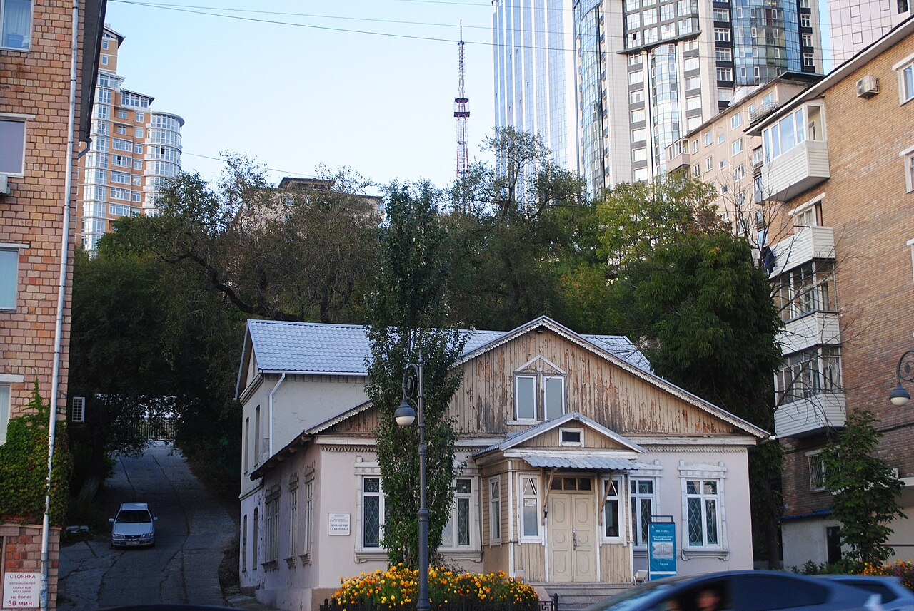

Фото: LoreMasterTes. [CC BY-SA 4.0](https://creativecommons.org/licenses/by-sa/4.0). [Оригинальная страница](https://commons.wikimedia.org/wiki/File:%D0%A1%D1%83%D1%85%D0%B0%D0%BD%D0%BE%D0%B2%D0%B0_9.jpg).

Дата снимка по источнику: 2017-09-10

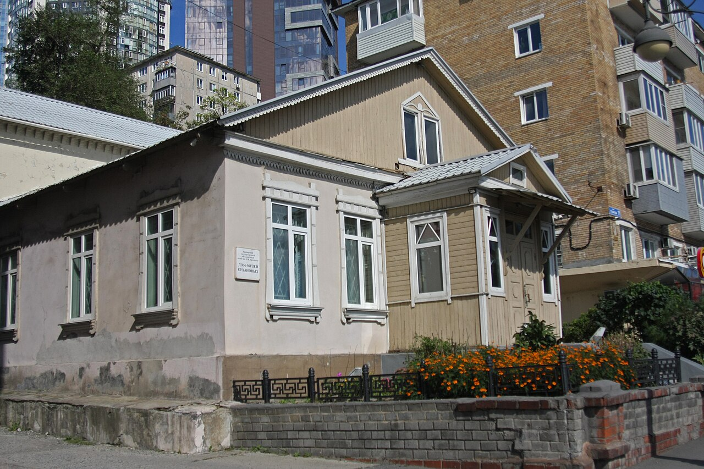

Фото: Кабанкова Валерия. [CC BY-SA 4.0](https://creativecommons.org/licenses/by-sa/4.0). [Оригинальная страница](https://commons.wikimedia.org/wiki/File:%D0%A1%D1%83%D1%85%D0%B0%D0%BD%D0%BE%D0%B2%D0%B0_9_%D0%94%D0%BE%D0%BC_%D0%A1%D1%83%D1%85%D0%B0%D0%BD%D0%BE%D0%B2%D1%8B%D1%85%2B.jpg).

Дата снимка по источнику: 2023-09-22

### Сквер имени Суханова

ID: `sukhanov-square`

Городской сквер имени Константина Суханова — небольшая зелёная остановка между прогулками по центру. Подходит для короткой паузы; сквер и дом-музей Сухановых — разные объекты.

Адрес: Владивосток, сквер имени Суханова

Источник: https://visit-primorye.ru/what-to-do/dom-muzej-semi-suhanovyh

Перед визитом: Часы, билеты, доступ и проходы уточняйте перед визитом. Фотографии могут быть сняты несколько лет назад.

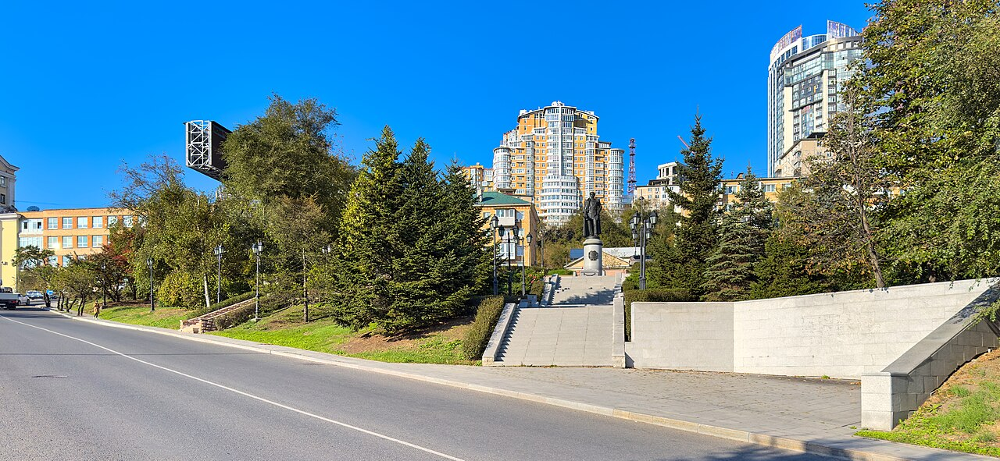

Фото: Vyacheslav Bukharov. [CC BY-SA 4.0](https://creativecommons.org/licenses/by-sa/4.0). [Оригинальная страница](https://commons.wikimedia.org/wiki/File:Streets_in_Vladivostok_(October_2024)-0_2.jpg).

Дата снимка по источнику: 2024-10-07 16:26:05

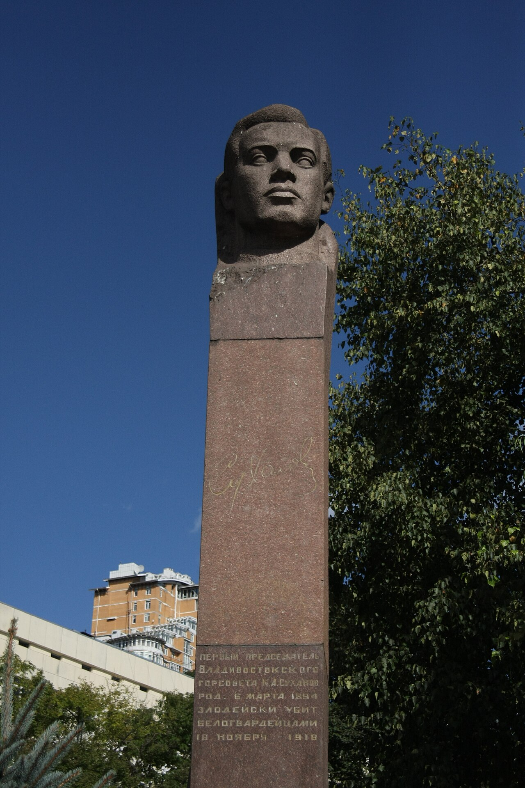

Фото: Кабанкова Валерия. [CC BY-SA 4.0](https://creativecommons.org/licenses/by-sa/4.0). [Оригинальная страница](https://commons.wikimedia.org/wiki/File:%D0%9F%D0%B0%D0%BC%D1%8F%D1%82%D0%BD%D0%B8%D0%BA_%D0%A1%D1%83%D1%85%D0%B0%D0%BD%D0%BE%D0%B2%D1%832.jpg).

Дата снимка по источнику: 2023-09-22

### Кирха Святого Павла

ID: `st-paul`

Лютеранская кирха на Пушкинской улице, узнаваемая по кирпичным фасадам и готическому силуэту. Здесь можно познакомиться с архитектурой и религиозной историей многонационального Владивостока.

Адрес: Владивосток, Пушкинская улица, 14

Источник: https://vladivostok-city.com/ru/places/all/all/934

Перед визитом: Часы, билеты, доступ и проходы уточняйте перед визитом. Фотографии могут быть сняты несколько лет назад.

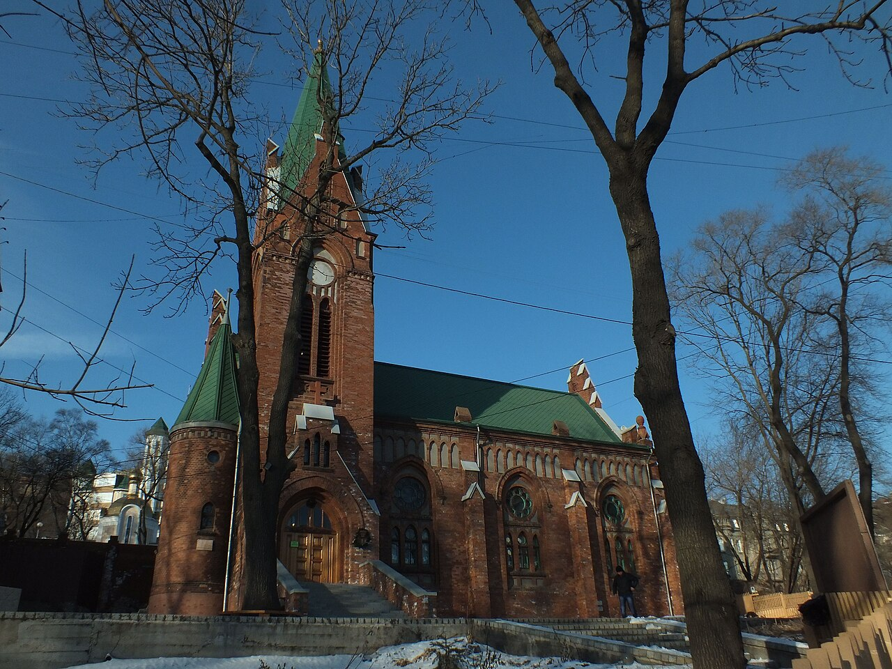

Фото: Andshel. [CC BY-SA 4.0](https://creativecommons.org/licenses/by-sa/4.0). [Оригинальная страница](https://commons.wikimedia.org/wiki/File:Church_of_St._Paul_(Vladivostok)_%D1%841.JPG).

Дата снимка по источнику: 2014-07-21 06:57:11

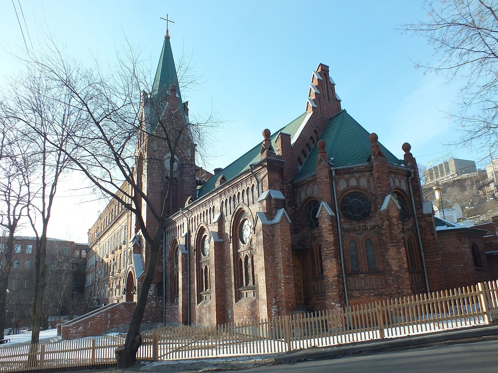

Фото: Andshel. [CC BY-SA 4.0](https://creativecommons.org/licenses/by-sa/4.0). [Оригинальная страница](https://commons.wikimedia.org/wiki/File:Church_of_St._Paul_(Vladivostok)%D1%842.JPG).

Дата снимка по источнику: 2014-07-21 06:57:05

### Пушкинский театр ДВФУ

ID: `pushkin-theatre`

Историческое здание на Пушкинской, 27, построенное в 1908 году для городского Собрания приказчиков. Сегодня театр ДВФУ объединяет спектакли, концерты, лекции и другие культурные события.

Адрес: Владивосток, Пушкинская улица, 27

Источник: https://www.culture.ru/institutes/85002/pushkinskii-teatr-dalnevostochnogo-federalnogo-universiteta

Перед визитом: Часы, билеты, доступ и проходы уточняйте перед визитом. Фотографии могут быть сняты несколько лет назад.

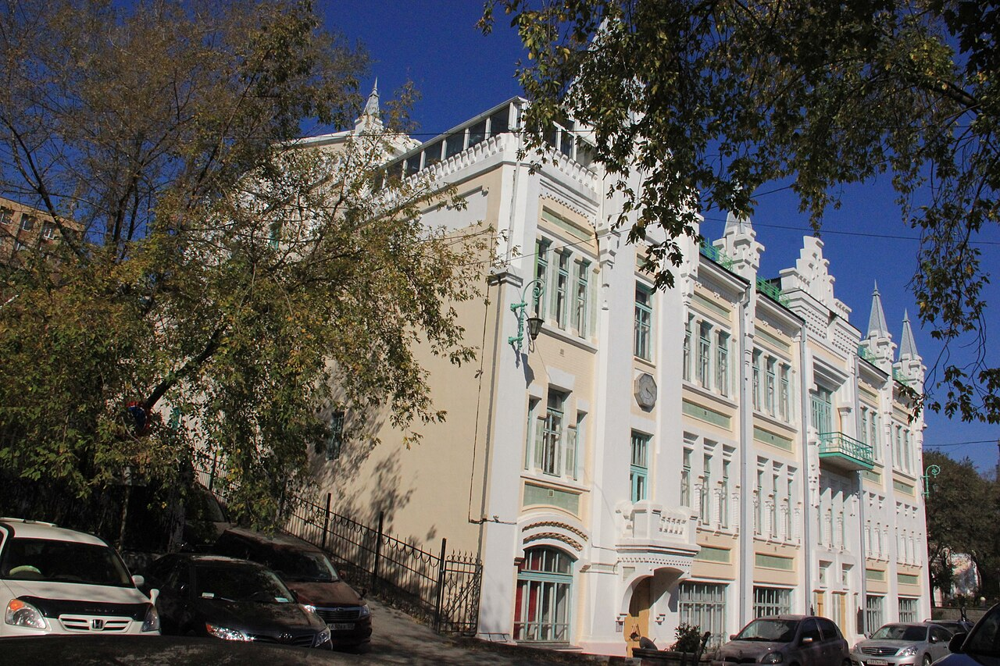

Фото: Tatiana Baloban. [CC BY-SA 3.0](https://creativecommons.org/licenses/by-sa/3.0). [Оригинальная страница](https://commons.wikimedia.org/wiki/File:%D0%9F%D1%83%D1%88%D0%BA%D0%B8%D0%BD%D1%81%D0%BA%D0%B0%D1%8F_27_(8).JPG).

Дата снимка по источнику: 2014-10-10 15:28:22

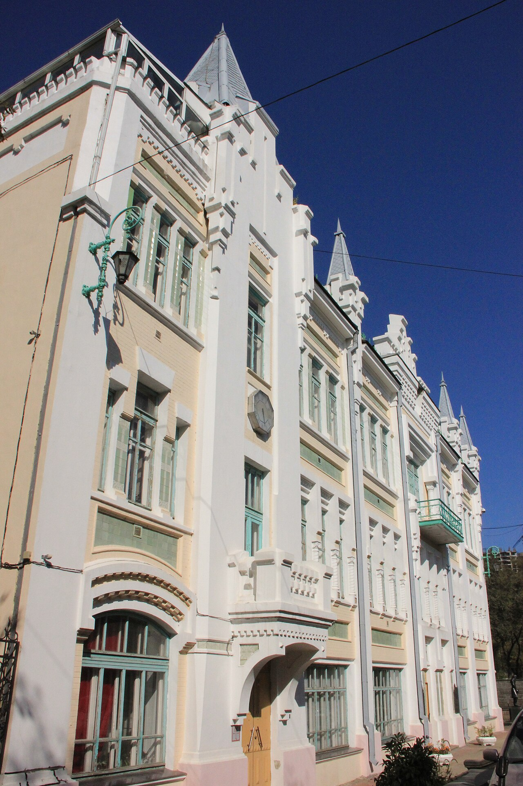

Фото: Tatiana Baloban. [CC BY-SA 3.0](https://creativecommons.org/licenses/by-sa/3.0). [Оригинальная страница](https://commons.wikimedia.org/wiki/File:%D0%A1%D0%BE%D0%B1%D1%80%D0%B0%D0%BD%D0%B8%D0%B5_%D0%BF%D1%80%D0%B8%D0%BA%D0%B0%D0%B7%D1%87%D0%B8%D0%BA%D0%BE%D0%B2,_%D0%9F%D1%80%D0%B8%D0%BC%D0%BE%D1%80%D1%81%D0%BA%D0%B8%D0%B9_%D0%BA%D1%80%D0%B0%D0%B9,_%D0%B3._%D0%92%D0%BB%D0%B0%D0%B4%D0%B8%D0%B2%D0%BE%D1%81%D1%82%D0%BE%D0%BA,_%D0%9F%D1%83%D1%88%D0%BA%D0%B8%D0%BD%D1%81%D0%BA%D0%B0%D1%8F_%D1%83%D0%BB%D0%B8%D1%86%D0%B0,_27.JPG).

Дата снимка по источнику: 2014-10-10 15:39:15

### Владивостокский фуникулёр

ID: `osm-way-133436813`

Два вагончика на склоне сопки Орлиной соединяют Пушкинскую и Суханова с 1962 года. Короткая поездка позволяет почувствовать рельеф города; перед визитом нужно проверить работу линии.

Адрес: Владивосток, улица Суханова, 29 — адрес OSM-метки станции

Источник: https://visit-primorye.ru/what-to-do/funikulyor

Перед визитом: Часы, билеты, доступ и проходы уточняйте перед визитом. Фотографии могут быть сняты несколько лет назад.

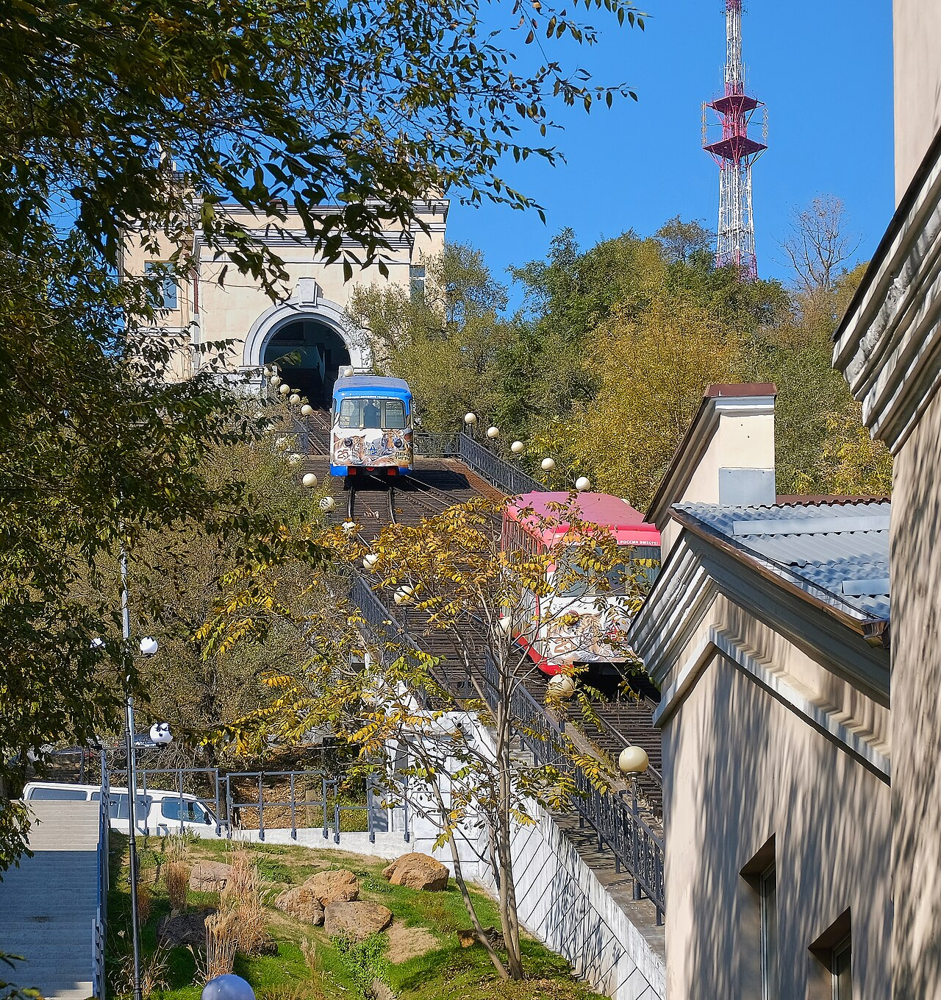

Фото: Vyacheslav Bukharov. [CC BY-SA 4.0](https://creativecommons.org/licenses/by-sa/4.0). [Оригинальная страница](https://commons.wikimedia.org/wiki/File:Vladivostok_Funicular_(October_2024)-0_5.jpg).

Дата снимка по источнику: 2024-10-11 09:44:27

### Площадка у Орлиного гнезда — кандидат

ID: `eagle-view`

Видовой район сопки Орлиной известен панорамами Владивостока и бухты Золотой Рог. Конкретная площадка и безопасный подход в проекте ещё не подтверждены: точка остаётся неактивным кандидатом.

Адрес: Владивосток, сопка Орлиное Гнездо

Источник: https://visit-primorye.ru/what-to-do/sopka-orlinoe-gnezdo

Перед визитом: Часы, билеты, доступ и проходы уточняйте перед визитом. Фотографии могут быть сняты несколько лет назад.

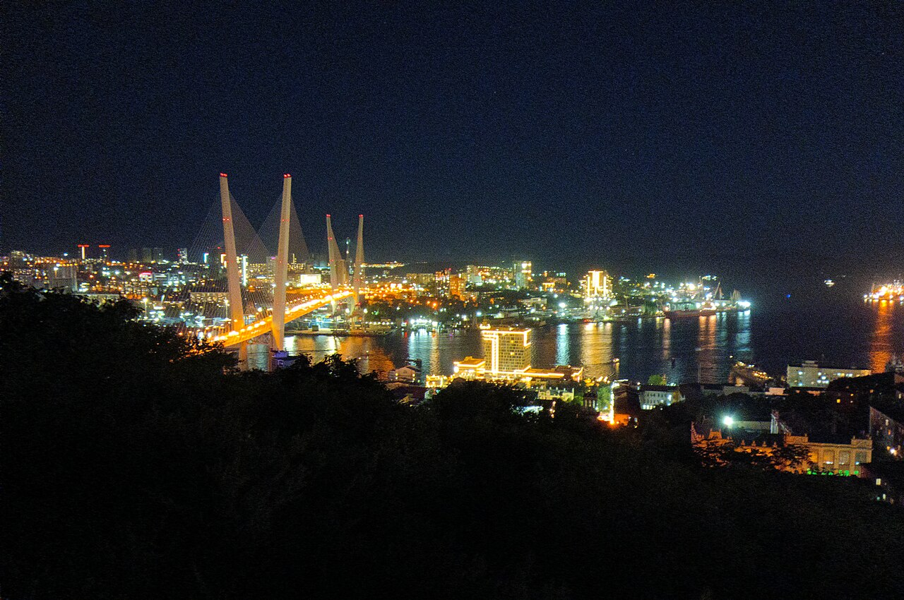

Фото: I13Robin. [CC BY 4.0](https://creativecommons.org/licenses/by/4.0). [Оригинальная страница](https://commons.wikimedia.org/wiki/File:2025-09-18-vdk-eagle-nest-night-201203.jpg).

Дата снимка по источнику: 2025-09-18 20:12:03

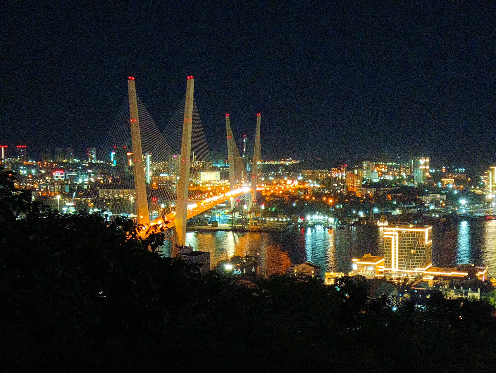

Фото: I13Robin. [CC BY 4.0](https://creativecommons.org/licenses/by/4.0). [Оригинальная страница](https://commons.wikimedia.org/wiki/File:2025-09-18-vdk-eagle-nest-night-201532.jpg).

Дата снимка по источнику: 2025-09-18 20:15:36

### Нагорный парк

ID: `nagorny`

Парк на Тюменской сопке с прогулочными дорожками и видовыми площадками над городом. Открыт в 2021 году; интересен сочетанием озеленённых пространств, рельефа и панорам Золотого Рога.

Адрес: Владивосток, сопка Тюменская

Источник: https://visit-primorye.ru/what-to-do/nagornyj-park

Перед визитом: Часы, билеты, доступ и проходы уточняйте перед визитом. Фотографии могут быть сняты несколько лет назад.

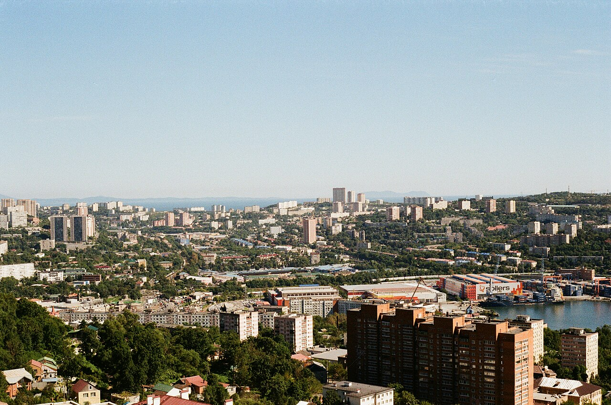

Фото: Artyom Svetlov. [CC BY 4.0](https://creativecommons.org/licenses/by/4.0). [Оригинальная страница](https://commons.wikimedia.org/wiki/File:Vladivostok_Nagorny_park_2024-09_033.jpg).

Дата снимка по источнику: Taken on 3 September 2024, 14:00:04 (according to   Exif   data)

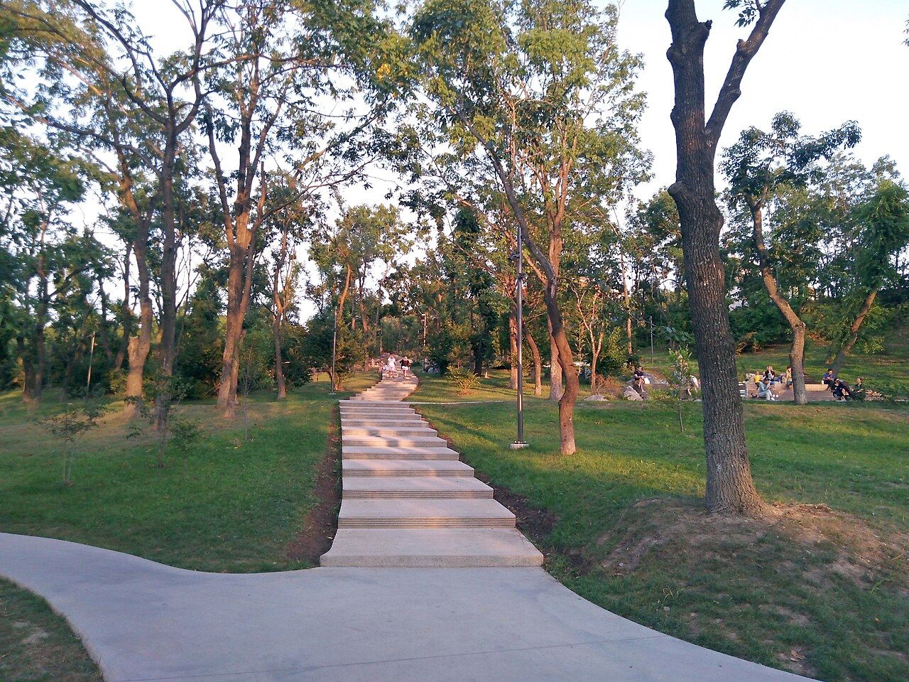

Фото: A. C. Tatarinov. [CC0](http://creativecommons.org/publicdomain/zero/1.0/deed.en). [Оригинальная страница](https://commons.wikimedia.org/wiki/File:%D0%9D%D0%B0%D0%B3%D0%BE%D1%80%D0%BD%D1%8B%D0%B9_%D0%BF%D0%B0%D1%80%D0%BA._%D0%A1%D0%BE%D0%BF%D0%BA%D0%B0_%D0%91%D1%83%D1%81%D1%81%D0%B5_2.jpg).

Дата снимка по источнику: 2021-08-18 19:35:29

### Каменные львы у Восточного института — кандидат

ID: `stone-lions`

Каменные фигуры львов у исторического здания Восточного института на Пушкинской улице. Это повод обратить внимание на восточные связи города и детали входа; доступ к конкретной точке требует проверки.

Адрес: Владивосток, Пушкинская улица, 10

Источник: https://cnbdvo.ru/item/2291576

Перед визитом: Часы, билеты, доступ и проходы уточняйте перед визитом. Фотографии могут быть сняты несколько лет назад.

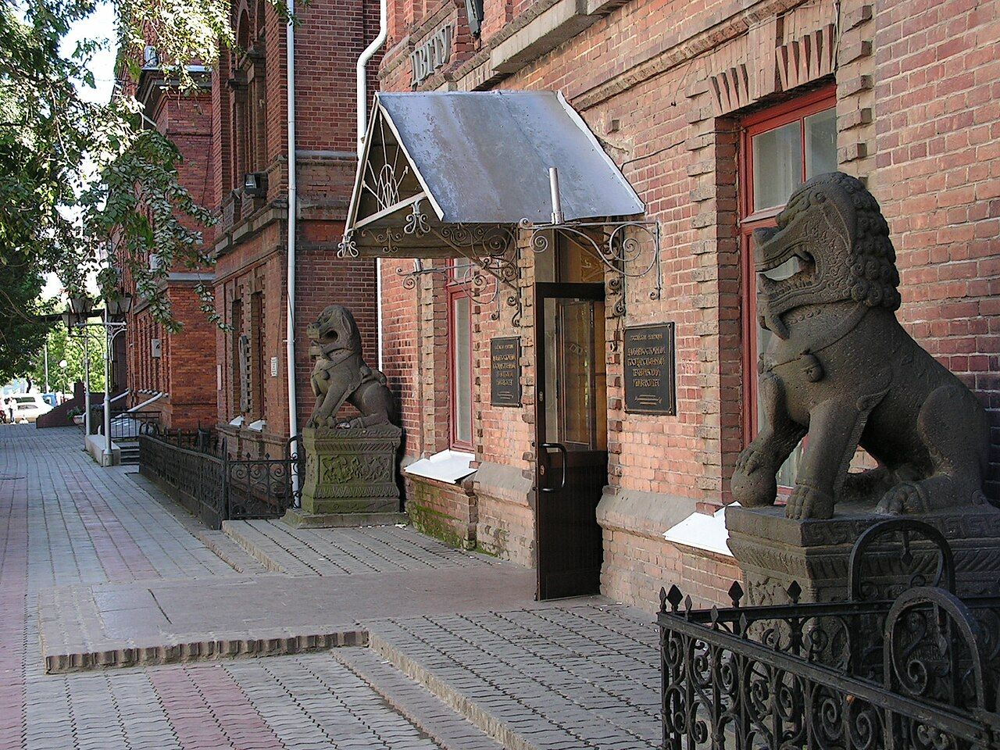

Фото: Yury Kirienko. [CC BY-SA 3.0](https://creativecommons.org/licenses/by-sa/3.0). [Оригинальная страница](https://commons.wikimedia.org/wiki/File:Guardian_lions_FESTU_Vladivostok.jpg).

Дата снимка по источнику: Taken on 22 September 2007

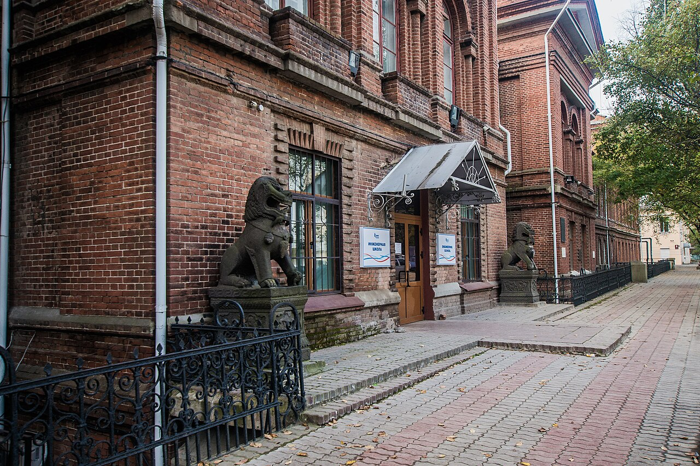

Фото: Genkayo. [CC BY-SA 3.0](https://creativecommons.org/licenses/by-sa/3.0). [Оригинальная страница](https://commons.wikimedia.org/wiki/File:%D0%97%D0%B4%D0%B0%D0%BD%D0%B8%D0%B5_%D0%92%D0%BE%D1%81%D1%82%D0%BE%D1%87%D0%BD%D0%BE%D0%B3%D0%BE_%D0%B8%D0%BD%D1%81%D1%82%D0%B8%D1%82%D1%83%D1%82%D0%B0.jpg).

Дата снимка по источнику: Taken on 29 September 2013, 09:43:59

### Памятник Элеоноре Лорд Прей

ID: `eleanor-pray`

Скульптура на Светланской посвящена Элеоноре Лорд Прей, чьи письма сохранили подробности городской жизни рубежа XIX–XX веков. Памятник установлен в 2014 году у Почтового переулка.

Адрес: Владивосток, Светланская улица, район домов 41–43

Источник: https://visit-primorye.ru/what-to-do/pamyatnik-eleonore-lord-prey

Перед визитом: Часы, билеты, доступ и проходы уточняйте перед визитом. Фотографии могут быть сняты несколько лет назад.

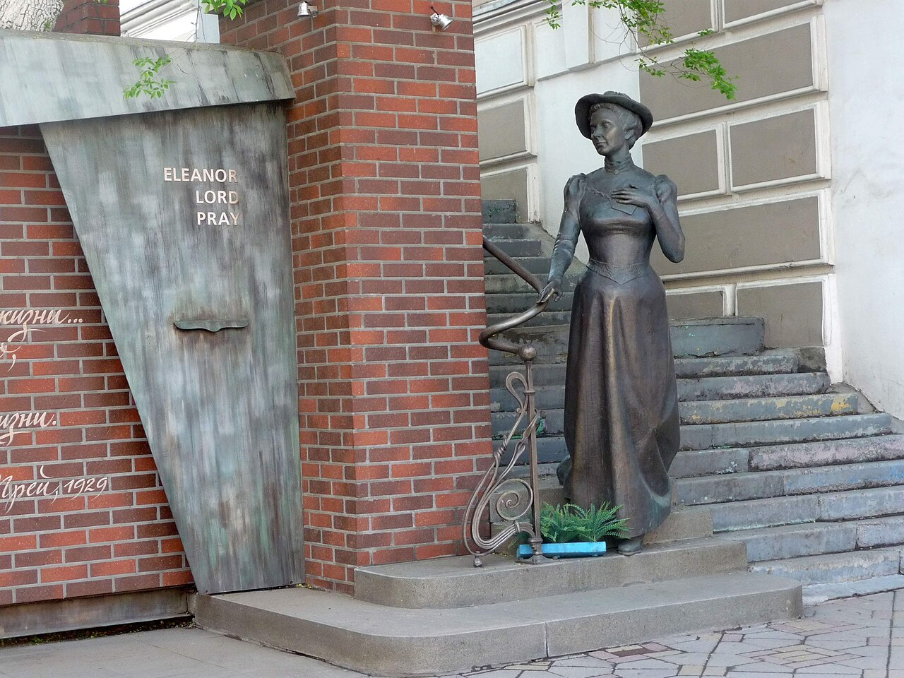

Фото: AdmiralHood. [CC BY-SA 4.0](https://creativecommons.org/licenses/by-sa/4.0). [Оригинальная страница](https://commons.wikimedia.org/wiki/File:%D0%92%D0%BB%D0%B0%D0%B4%D0%B8%D0%B2%D0%BE%D1%81%D1%82%D0%BE%D0%BA,_%D0%BF%D0%B0%D0%BC%D1%8F%D1%82%D0%BD%D0%B8%D0%BA_%D0%AD%D0%BB%D0%B5%D0%BE%D0%BD%D0%BE%D1%80%D0%B5_%D0%9F%D1%80%D0%B5%D0%B9,_2015-05-22,_%D0%B0.JPG).

Дата снимка по источнику: 2015-05-22

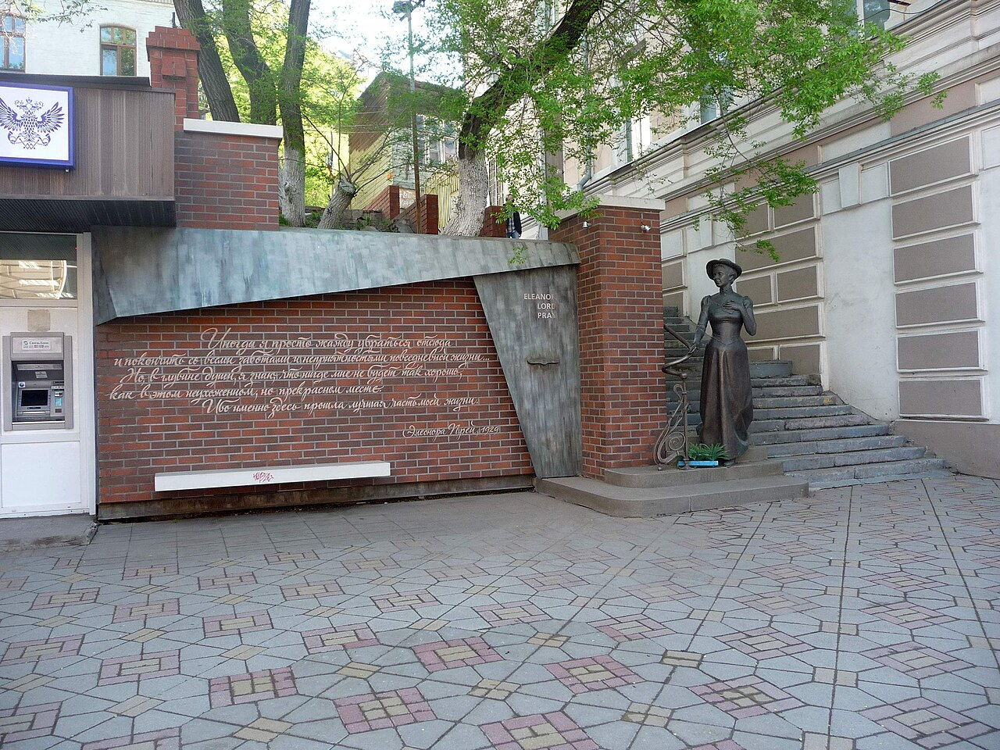

Фото: AdmiralHood. [CC BY-SA 4.0](https://creativecommons.org/licenses/by-sa/4.0). [Оригинальная страница](https://commons.wikimedia.org/wiki/File:%D0%92%D0%BB%D0%B0%D0%B4%D0%B8%D0%B2%D0%BE%D1%81%D1%82%D0%BE%D0%BA,_%D0%BF%D0%B0%D0%BC%D1%8F%D1%82%D0%BD%D0%B8%D0%BA_%D0%AD%D0%BB%D0%B5%D0%BE%D0%BD%D0%BE%D1%80%D0%B5_%D0%9F%D1%80%D0%B5%D0%B9,_2015-05-22.JPG).

Дата снимка по источнику: 2015-05-22

### Николаевские триумфальные ворота

ID: `nikolaev-gate`

Нарядная триумфальная арка связана с посещением Владивостока цесаревичем Николаем в 1891 году. Удобная остановка для разговора о городской памяти и архитектурных символах.

Адрес: Владивосток, улица Петра Великого, район дома 8

Источник: https://visit-primorye.ru/what-to-do/nikolaevskie-triumfalnye-vorota

Перед визитом: Часы, билеты, доступ и проходы уточняйте перед визитом. Фотографии могут быть сняты несколько лет назад.

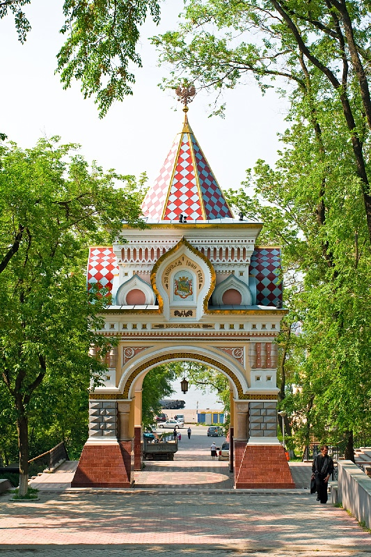

Фото: Russian.dissident. [Public domain](https://commons.wikimedia.org/wiki/File:Triumphal_arch_Cesarevitch_Nikolay.jpg). [Оригинальная страница](https://commons.wikimedia.org/wiki/File:Triumphal_arch_Cesarevitch_Nikolay.jpg).

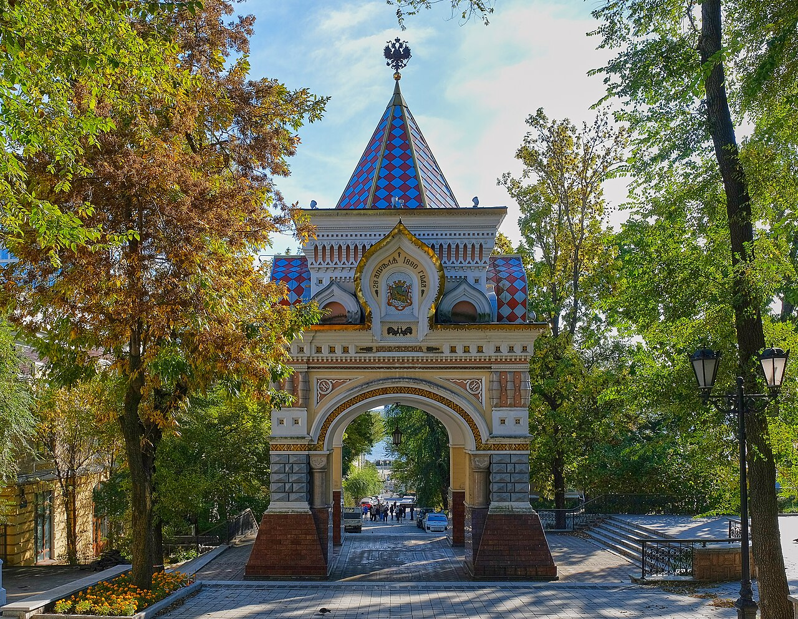

Фото: Vyacheslav Bukharov. [CC BY-SA 4.0](https://creativecommons.org/licenses/by-sa/4.0). [Оригинальная страница](https://commons.wikimedia.org/wiki/File:Triumphal_arch_in_Vladivostok_(October_2024)-0.jpg).

Дата снимка по источнику: 2024-10-07 11:34:59

### Подводная лодка-музей С-56

ID: `s56`

Подводная лодка на Корабельной набережной служит музеем и мемориальным объектом. Снаружи можно рассмотреть сам корабль, а для знакомства с внутренней экспозицией нужно отдельно уточнять условия посещения.

Адрес: Владивосток, Корабельная набережная

Источник: https://visit-primorye.ru/what-to-do/gvardejskaya-krasnoznamennaya-podvodnaya-lodka-s-56

Перед визитом: Часы, билеты, доступ и проходы уточняйте перед визитом. Фотографии могут быть сняты несколько лет назад.

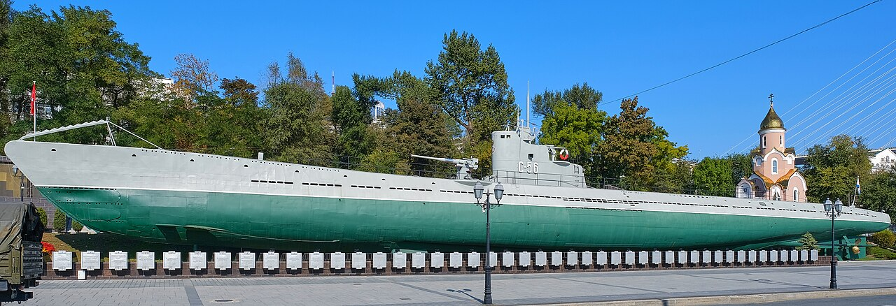

Фото: Vyacheslav Bukharov. [CC BY-SA 4.0](https://creativecommons.org/licenses/by-sa/4.0). [Оригинальная страница](https://commons.wikimedia.org/wiki/File:S-56_Submarine_Monument_in_Vladivostok_(October_2024)-0_2.jpg).

Дата снимка по источнику: 2024-10-08 10:23:35

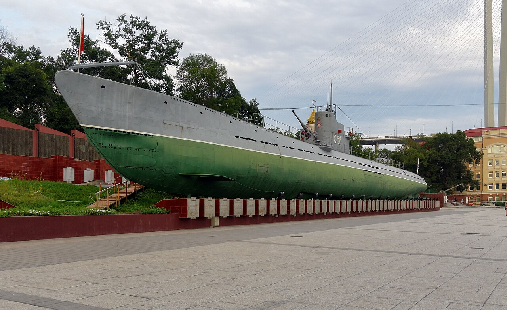

Фото: Alexxx1979. [CC BY-SA 4.0](https://creativecommons.org/licenses/by-sa/4.0). [Оригинальная страница](https://commons.wikimedia.org/wiki/File:Vladivostok_Submarine_S-56_P8050502_2200.jpg).

Дата снимка по источнику: 2015-08-05 12:17:32

### Мемориальный корабль «Красный вымпел»

ID: `red-pennant`

Исторический корабль у Корабельной набережной был построен в 1911 году и первоначально носил имя «Адмирал Завойко». Его история связывает морские путешествия и становление флота на Дальнем Востоке.

Адрес: Владивосток, Корабельная набережная

Источник: https://www.culture.ru/institutes/8487/memorialnyi-korabl-krasnyi-vympel

Перед визитом: Часы, билеты, доступ и проходы уточняйте перед визитом. Фотографии могут быть сняты несколько лет назад.

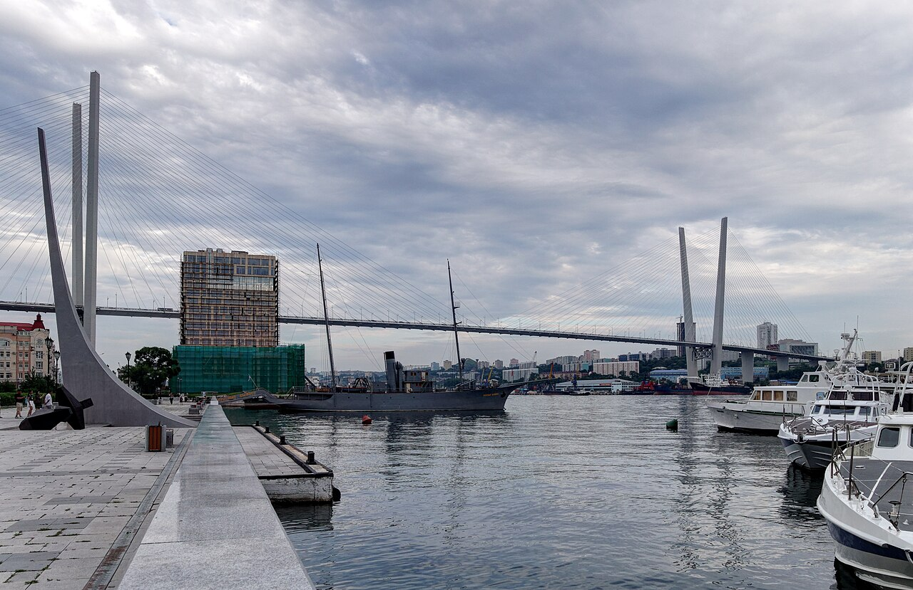

Фото: Alexxx1979. [CC BY-SA 4.0](https://creativecommons.org/licenses/by-sa/4.0). [Оригинальная страница](https://commons.wikimedia.org/wiki/File:Vladivostok_Patrol_boat_Krasny_vympel_DSC00675_2200.jpg).

Дата снимка по источнику: 2015-08-05 11:58:00

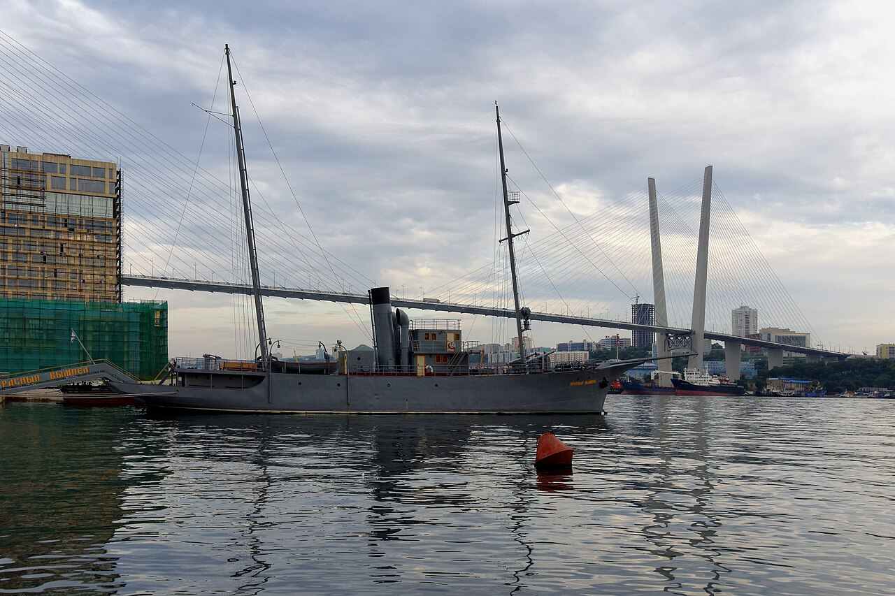

Фото: Alexxx1979. [CC BY-SA 4.0](https://creativecommons.org/licenses/by-sa/4.0). [Оригинальная страница](https://commons.wikimedia.org/wiki/File:Vladivostok_Patrol_boat_Krasny_vympel_P8050470_2200.jpg).

Дата снимка по источнику: 2015-08-05 11:58:27

### Памятник адмиралу Г. И. Невельскому

ID: `nevelskoy-monument`

Памятник мореплавателю и исследователю Геннадию Невельскому на Светланской улице установлен в 1897 году. Остановка помогает связать историю города с изучением Дальнего Востока.

Адрес: Владивосток, Светланская улица, район дома 67

Источник: https://visit-primorye.ru/what-to-do/pamyatnik-admiralu-g-i-nevelskomu

Перед визитом: Часы, билеты, доступ и проходы уточняйте перед визитом. Фотографии могут быть сняты несколько лет назад.

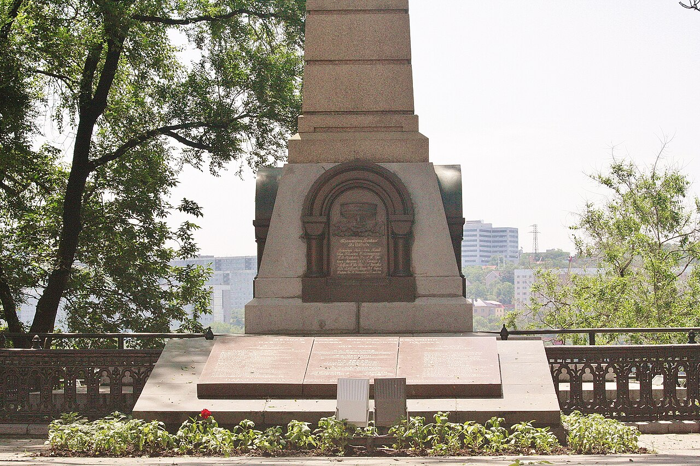

Фото: Marishka6941 Трезвые грузчики. [Public domain](https://commons.wikimedia.org/wiki/File:%D0%9F%D0%B0%D0%BC%D1%8F%D1%82%D0%BD%D0%B8%D0%BA_%D0%93.%D0%98._%D0%9D%D0%B5%D0%B2%D0%B5%D0%BB%D1%8C%D1%81%D0%BA%D0%BE%D0%BC%D1%832.JPG). [Оригинальная страница](https://commons.wikimedia.org/wiki/File:%D0%9F%D0%B0%D0%BC%D1%8F%D1%82%D0%BD%D0%B8%D0%BA_%D0%93.%D0%98._%D0%9D%D0%B5%D0%B2%D0%B5%D0%BB%D1%8C%D1%81%D0%BA%D0%BE%D0%BC%D1%832.JPG).

### Набережная Цесаревича

ID: `tsesarevich-embankment`

Прогулочное пространство у бухты Золотой Рог, открытое в 2012 году. Морские виды, Золотой мост и соседние промышленные здания создают характерный для Владивостока городской пейзаж.

Адрес: Владивосток, набережная Цесаревича

Источник: https://visit-primorye.ru/what-to-do/naberezhnaya-cesarevicha

Перед визитом: Часы, билеты, доступ и проходы уточняйте перед визитом. Фотографии могут быть сняты несколько лет назад.

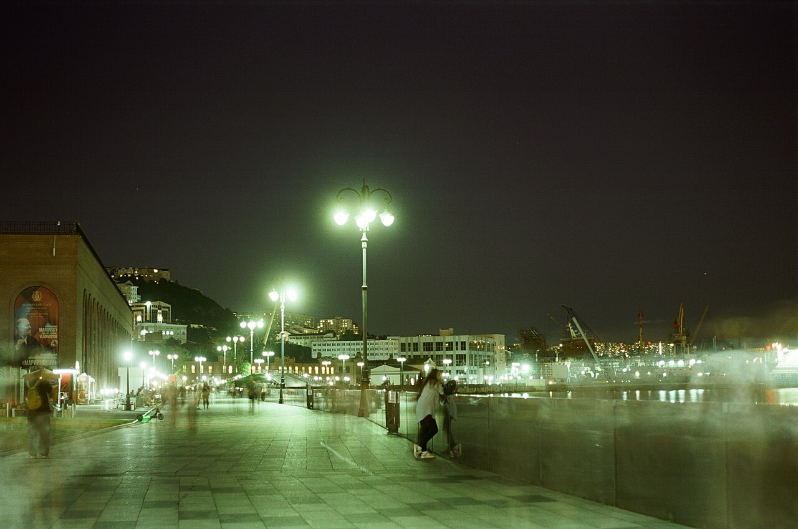

Фото: Artyom Svetlov. [CC BY 4.0](https://creativecommons.org/licenses/by/4.0). [Оригинальная страница](https://commons.wikimedia.org/wiki/File:Vladivostok_Naberezhnaya_Tsesarevicha_2024-09_32.jpg).

Дата снимка по источнику: Taken on 2 September 2024, 16:00:00 (according to   Exif   data)

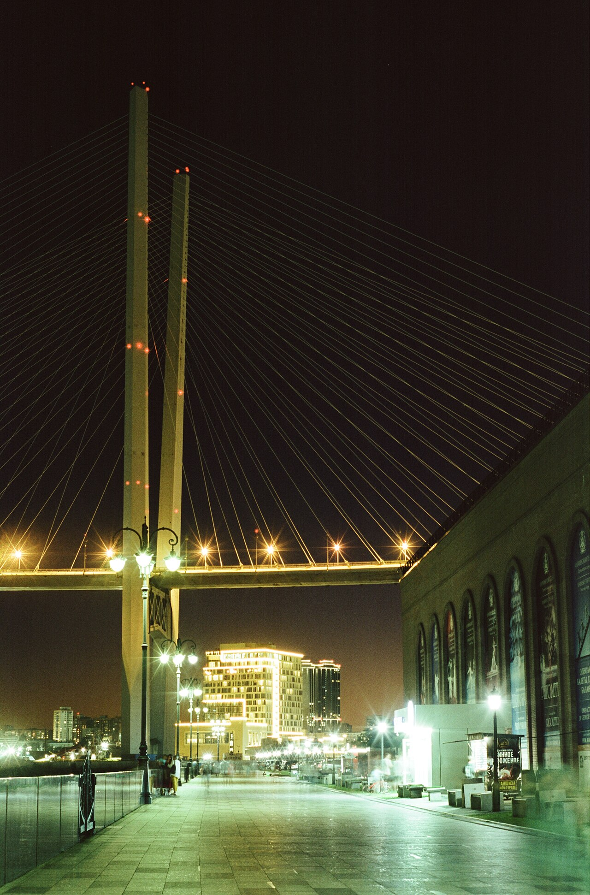

Фото: Artyom Svetlov. [CC BY 4.0](https://creativecommons.org/licenses/by/4.0). [Оригинальная страница](https://commons.wikimedia.org/wiki/File:Vladivostok_Naberezhnaya_Tsesarevicha_2024-09_35.jpg).

Дата снимка по источнику: Taken on 2 September 2024, 16:00:00 (according to   Exif   data)

### Военно-исторический музей Тихоокеанского флота

ID: `osm-node-676375880`

Музей на Светланской, 66, посвящён истории Тихоокеанского флота. Экспозиция знакомит с морской службой через документы и предметы; посещение залов планируется отдельно от наружной прогулки.

Адрес: Владивосток, Светланская улица, 66

Источник: https://visit-primorye.ru/what-to-do/voenno-istoricheskij-muzej-tihookeanskogo-flota

Перед визитом: Часы, билеты, доступ и проходы уточняйте перед визитом. Фотографии могут быть сняты несколько лет назад.

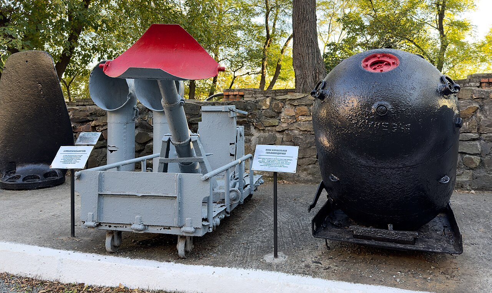

Фото: Vyacheslav Bukharov. [CC BY-SA 4.0](https://creativecommons.org/licenses/by-sa/4.0). [Оригинальная страница](https://commons.wikimedia.org/wiki/File:Vladivostok_Military-historical_Museum_of_the_Pacific_fleet_(October_2024)-0.jpg).

Дата снимка по источнику: 2024-10-07 17:24:33

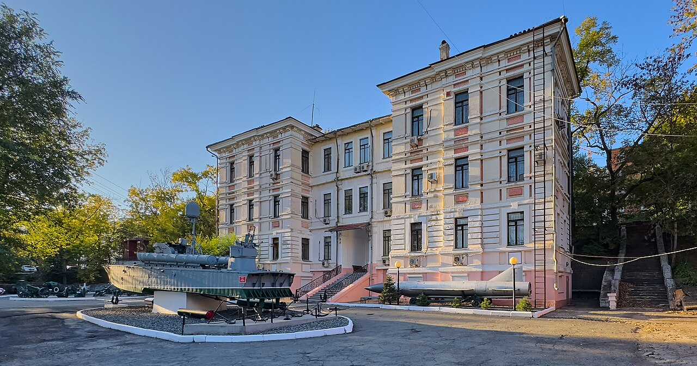

Фото: Vyacheslav Bukharov. [CC BY-SA 4.0](https://creativecommons.org/licenses/by-sa/4.0). [Оригинальная страница](https://commons.wikimedia.org/wiki/File:Vladivostok_Military-historical_Museum_of_the_Pacific_fleet_(October_2024)-0_10.jpg).

Дата снимка по источнику: 2024-10-07 17:28:38

### Приморский драматический театр имени Максима Горького

ID: `osm-way-26537156`

Драматический театр на Светланской, 49, — вариант для вечернего культурного досуга. Можно включить здание в прогулку, а спектакль выбрать отдельно по официальной афише.

Адрес: Владивосток, Светланская улица, 49

Источник: https://gorkytheater.ru/contacts

Перед визитом: Часы, билеты, доступ и проходы уточняйте перед визитом. Фотографии могут быть сняты несколько лет назад.

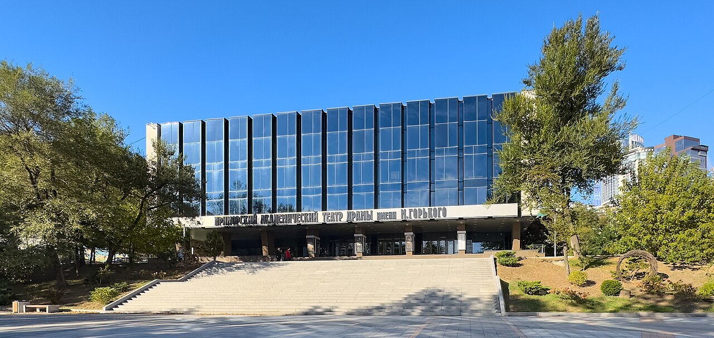

Фото: Vyacheslav Bukharov. [CC BY-SA 4.0](https://creativecommons.org/licenses/by-sa/4.0). [Оригинальная страница](https://commons.wikimedia.org/wiki/File:Gorky_Theater_in_Vladivostok_(October_2024).jpg).

Дата снимка по источнику: 2024-10-07 16:18:38

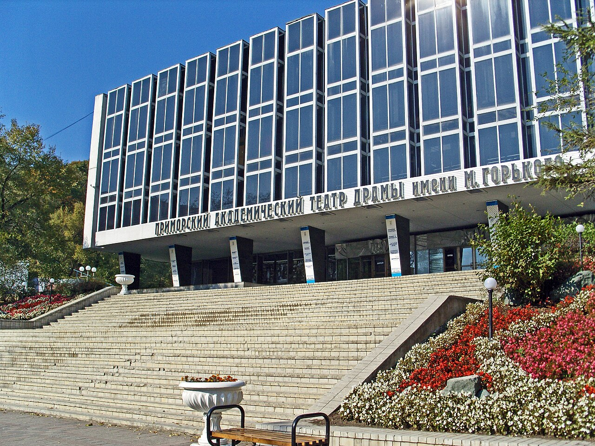

Фото: Pavel K  F pkalac. [CC BY-SA 3.0](https://creativecommons.org/licenses/by-sa/3.0). [Оригинальная страница](https://commons.wikimedia.org/wiki/File:Vladivostok_Gorky_Drama_Theatre_2010-10_1286866053.jpg).

Дата снимка по источнику: Taken on 12 October 2010

### Парк «Минный городок» — отдельная проверка

ID: `minny-park`

Парк «Минный городок» на Адмирала Юмашева связан с историей территории и семейным отдыхом. Объект остаётся вне активной демонстрационной подборки: актуальные зоны, доступ и билеты нужно уточнять.

Адрес: Владивосток, район улицы Адмирала Юмашева, 14г

Источник: https://visit-primorye.ru/what-to-do/park-minnyj-gorodok

Перед визитом: Часы, билеты, доступ и проходы уточняйте перед визитом. Фотографии могут быть сняты несколько лет назад.

Фото: подходящий файл со свободной лицензией пока не включён.

### Полка.Кофе

ID: `guide-e01`

кофе и короткая пауза во время прогулки по Пушкинской.

Адрес: Пушкинская, 27, здание Пушкинского театра, первый этаж.

Источник: https://totadres.ru/vladivostok/org/polka_kofe/5092298

Перед визитом: существует ли сейчас точка, доступен ли вход при закрытом театре, актуальное меню и график. Туалет не подтверждён.

Цены (ранее собранный ориентир, не подтверждён заново): 200 ₽. Это опубликованный ориентир кофейни, не обещание полноценного обеда.

Фото: подходящий файл со свободной лицензией пока не включён.

### Столовая №5

ID: `guide-e02`

кандидат на простой дневной обед: суп, основное блюдо, салат.

Адрес: Светланская, 115, первый этаж.

Источник: https://urbanplaces.su/ru_primorskij-kraj/vladivostokskij-gorodskoj-okrug-vladivostok/card-2217223-stolovaya-5

Перед визитом: свободный вход для внешних посетителей, реальную работу, актуальные цены. Источник указывает узкое дневное окно по будням, поэтому не предлагать автоматически вечером и в выходные.

Цены (ранее собранный ориентир, не подтверждён заново): 250 ₽; сумма требует особенно внимательной проверки по текущему меню.

Фото: подходящий файл со свободной лицензией пока не включён.

### Helsy

ID: `guide-e03`

кафе с более широким выбором еды, чем у кофейной точки; кандидат для обеда.

Адрес: Светланская, 33, строение 2, первый этаж.

Источник: https://totadres.ru/vladivostok/org/helsy/3768664

Перед визитом: районную принадлежность, действующий вход, меню и открытие. Санузел для негостей не подтверждён.

Цены (ранее собранный ориентир, не подтверждён заново): 700 ₽.

Фото: подходящий файл со свободной лицензией пока не включён.

### Калачная17

ID: `guide-e04`

выпечка, десерт и напиток; остановка для завтрака или перекуса.

Адрес: Светланская, 33, строение 2.

Источник: https://visit-primorye.ru/where-to-eat/pekarnya-konditerskaya-kalachnaya17

Перед визитом: конкретный вход, район и сегодняшнее меню. Режим филиала на странице есть, но перед показом его нужно перепроверить.

Цены (ранее собранный ориентир, не подтверждён заново): 600 ₽.

Фото: подходящий файл со свободной лицензией пока не включён.

### Дамплинг Репаблик

ID: `guide-e05`

азиатская кухня; кандидат на полноценный приём пищи.

Адрес: Светланская, 31.

Источник: https://visit-primorye.ru/where-to-eat/kafe-dampling-repablik

Перед визитом: действующий филиал, вход, меню, район и наличие мест. Цена доставки не заменяет средний чек посещения.

Цены (ранее собранный ориентир, не подтверждён заново): 1 200 ₽.

Фото: подходящий файл со свободной лицензией пока не включён.

### Сыроварня

ID: `guide-e06`

ресторан для более долгого посещения компанией; это не бюджетный перекус.

Адрес: Светланская, 37А.

Источник: https://visit-primorye.ru/where-to-eat/restoran-syrovarnya

Перед визитом: актуальное меню, вход, район и необходимость бронирования. Терраса сезонная; её доступность не обещать.

Цены (ранее собранный ориентир, не подтверждён заново): 2 500 ₽.

Фото: подходящий файл со свободной лицензией пока не включён.

### OkiDoki на Луговой

ID: `guide-e07`

пицца и другие блюда для остановки в районе Луговой, отдельно от центральных прогулок.

Адрес: Луговая, 18.

Источник: https://www.restoclub.ru/vld/place/okidoki

Перед визитом: наличие филиала сейчас, точный вход, актуальную стоимость заказа и посадку. До проверки ориентир 1 300 ₽ показывать только с названием источника.

Цены (ранее собранный ориентир, не подтверждён заново): 1 300 ₽. В других справочниках встречаются существенно меньшие числа; не объединять их в искусственное «среднее».

Фото: подходящий файл со свободной лицензией пока не включён.

### Nem

ID: `guide-e08`

кафе; дополнительный кандидат для центральной части подборки.

Адрес: Светланская, 45, шестой этаж.

Источник: https://orgzz.ru/vladivostok/fastfud/adr/86137/svetlanskaya

Перед визитом: работает ли заведение под этим именем, как попасть на этаж, есть ли лифт и действующее меню. До этого не рекомендовать человеку с срочной потребностью.

Цены (ранее собранный ориентир, не подтверждён заново): 500 ₽.

Фото: подходящий файл со свободной лицензией пока не включён.

### Кофемашина

ID: `guide-e09`

автокафе, кандидат на напиток и еду навынос.

Адрес: Светланская, 152, строение 4.

Источник: https://orgzz.ru/vladivostok/fastfud/adr/86137/svetlanskaya

Перед визитом: точный формат обслуживания, возможность безопасно подойти пешком, текущее меню и график. Пометка «круглосуточно» в справочнике не подтверждена звонком; круглосуточность в рекомендациях пока не обещаем.

Цены (ранее собранный ориентир, не подтверждён заново): 450 ₽.

Фото: подходящий файл со свободной лицензией пока не включён.

### Хлопок Чайхона

ID: `guide-e10`

кафе восточной кухни; потенциально подходит для спокойного обеда после прогулки. Статус: резерв с повышенным риском устаревания. На том же адресе найдено заведение «Практика» с другим чеком. Это может означать смену заведения, разные помещения или старые сведения; причина не установлена.

Адрес: Светланская, 83.

Источник: https://vladivostok-city.com/ru/restaraunts/all/all/847

Перед визитом: 

Цены (ранее собранный ориентир, не подтверждён заново): 1 250 ₽.

Фото: подходящий файл со свободной лицензией пока не включён.

### Кинотеатр Уссури

ID: `guide-f01`

Что делать: выбрать сеанс, удобно сочетать с отдельной остановкой на еду. Стоимость: по фильму, залу, месту и времени; универсальной цены билета нет. Не сохранять минимальную стоимость случайного сеанса как постоянную.

Адрес: Светланская, 31.

Источник: https://www.illuzion.ru/cinema/ussuri

Перед визитом: район, выбранный сеанс, возраст и время окончания; санузел для случайных прохожих не подтверждён.

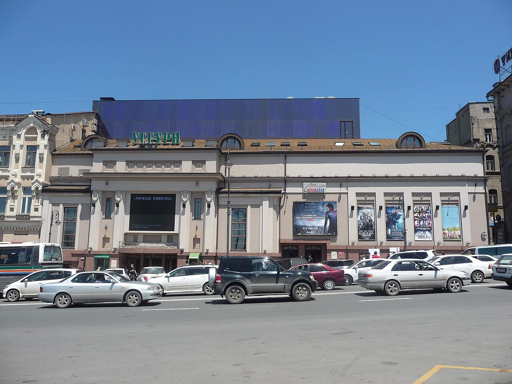

Фото: AdmiralHood. [CC BY-SA 3.0](https://creativecommons.org/licenses/by-sa/3.0). [Оригинальная страница](https://commons.wikimedia.org/wiki/File:%D0%92%D0%BB%D0%B0%D0%B4%D0%B8%D0%B2%D0%BE%D1%81%D1%82%D0%BE%D0%BA,_%D0%A1%D0%B2%D0%B5%D1%82%D0%BB%D0%B0%D0%BD%D1%81%D0%BA%D0%B0%D1%8F,_31,_%D0%BA%D0%B8%D0%BD%D0%BE%D1%82%D0%B5%D0%B0%D1%82%D1%80_%C2%AB%D0%A3%D1%81%D1%81%D1%83%D1%80%D0%B8%C2%BB,_2012-06-22.jpg).

Дата снимка по источнику: 2012-06-22

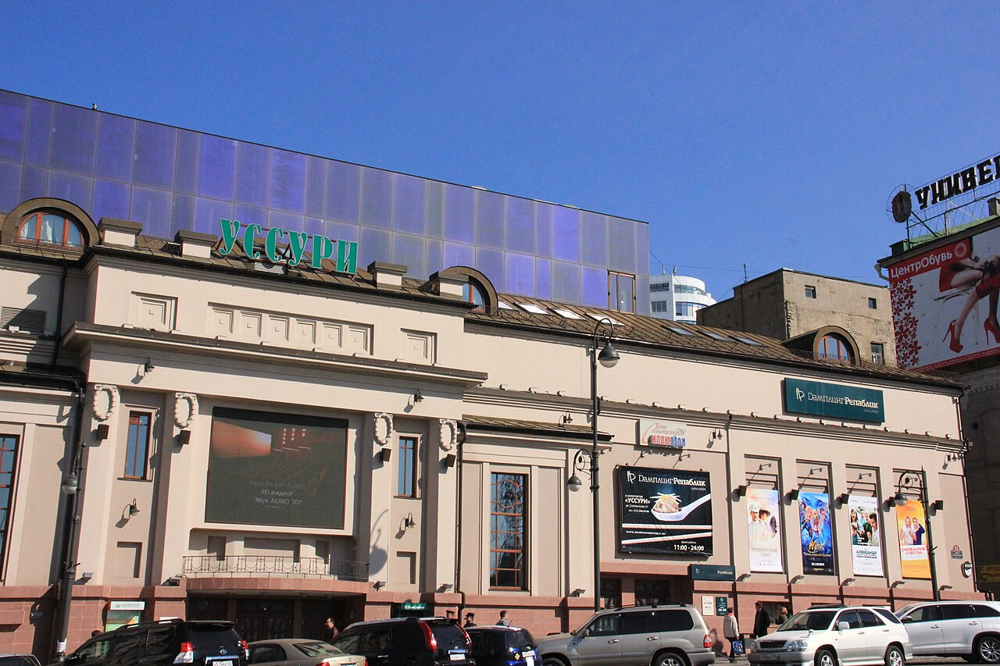

Фото: Tatiana Baloban. [CC BY-SA 3.0](https://creativecommons.org/licenses/by-sa/3.0). [Оригинальная страница](https://commons.wikimedia.org/wiki/File:%D0%97%D0%B4%D0%B0%D0%BD%D0%B8%D0%B5_%D0%BA%D0%B8%D0%BD%D0%BE%D1%82%D0%B5%D0%B0%D1%82%D1%80%D0%B0_%22%D0%A3%D1%81%D1%81%D1%83%D1%80%D0%B8%22,_%D0%BE%D0%B1%D1%80%D0%B0%D0%B7%D0%B5%D1%86_%D0%B7%D0%B0%D1%81%D1%82%D1%80%D0%BE%D0%B9%D0%BA%D0%B8_%D1%83%D0%BB%D0%B8%D1%86%D1%8B,_%D0%B3._%D0%92%D0%BB%D0%B0%D0%B4%D0%B8%D0%B2%D0%BE%D1%81%D1%82%D0%BE%D0%BA,_%D1%83%D0%BB._%D0%A1%D0%B2%D0%B5%D1%82%D0%BB%D0%B0%D0%BD%D1%81%D0%BA%D0%B0%D1%8F,_31.JPG).

Дата снимка по источнику: 2014-10-10 12:59:36

### Театр имени Горького

ID: `guide-f02`

Драматический театр на Светланской, 49, — вариант для вечернего культурного досуга. Можно включить здание в прогулку, а спектакль выбрать отдельно по официальной афише.

Адрес: Светланская, 49.

Источник: https://gorkytheater.ru/events/

Перед визитом: дату, возраст, продолжительность и билет. Часы кассы не являются временем спектакля.

Фото: Vyacheslav Bukharov. [CC BY-SA 4.0](https://creativecommons.org/licenses/by-sa/4.0). [Оригинальная страница](https://commons.wikimedia.org/wiki/File:Gorky_Theater_in_Vladivostok_(October_2024).jpg).

Дата снимка по источнику: 2024-10-07 16:18:38

Фото: Pavel K  F pkalac. [CC BY-SA 3.0](https://creativecommons.org/licenses/by-sa/3.0). [Оригинальная страница](https://commons.wikimedia.org/wiki/File:Vladivostok_Gorky_Drama_Theatre_2010-10_1286866053.jpg).

Дата снимка по источнику: Taken on 12 October 2010

### Пушкинский театр

ID: `guide-f03`

Историческое здание на Пушкинской, 27, построенное в 1908 году для городского Собрания приказчиков. Сегодня театр ДВФУ объединяет спектакли, концерты, лекции и другие культурные события.

Адрес: Пушкинская, 27.

Источник: https://www.culture.ru/institutes/85002/pushkinskii-teatr-dalnevostochnogo-federalnogo-universiteta

Перед визитом: текущую работу здания и событие; старое описание учреждения не гарантирует вход сегодня.

Фото: Tatiana Baloban. [CC BY-SA 3.0](https://creativecommons.org/licenses/by-sa/3.0). [Оригинальная страница](https://commons.wikimedia.org/wiki/File:%D0%9F%D1%83%D1%88%D0%BA%D0%B8%D0%BD%D1%81%D0%BA%D0%B0%D1%8F_27_(8).JPG).

Дата снимка по источнику: 2014-10-10 15:28:22

Фото: Tatiana Baloban. [CC BY-SA 3.0](https://creativecommons.org/licenses/by-sa/3.0). [Оригинальная страница](https://commons.wikimedia.org/wiki/File:%D0%A1%D0%BE%D0%B1%D1%80%D0%B0%D0%BD%D0%B8%D0%B5_%D0%BF%D1%80%D0%B8%D0%BA%D0%B0%D0%B7%D1%87%D0%B8%D0%BA%D0%BE%D0%B2,_%D0%9F%D1%80%D0%B8%D0%BC%D0%BE%D1%80%D1%81%D0%BA%D0%B8%D0%B9_%D0%BA%D1%80%D0%B0%D0%B9,_%D0%B3._%D0%92%D0%BB%D0%B0%D0%B4%D0%B8%D0%B2%D0%BE%D1%81%D1%82%D0%BE%D0%BA,_%D0%9F%D1%83%D1%88%D0%BA%D0%B8%D0%BD%D1%81%D0%BA%D0%B0%D1%8F_%D1%83%D0%BB%D0%B8%D1%86%D0%B0,_27.JPG).

Дата снимка по источнику: 2014-10-10 15:39:15

### Владивостокский цирк

ID: `guide-f04`

Что делать: представление по действующей афише. Стоимость: по шоу и месту; не уточнена для даты пользователя.

Адрес: Светланская, 103.

Источник: https://www.circus-vladivostok.ru/index.html

Перед визитом: актуальное представление. Найденная страница содержит летний анонс 2026 года, завершившийся в сентябре, — не выдавать его за текущую ноябрьскую программу.

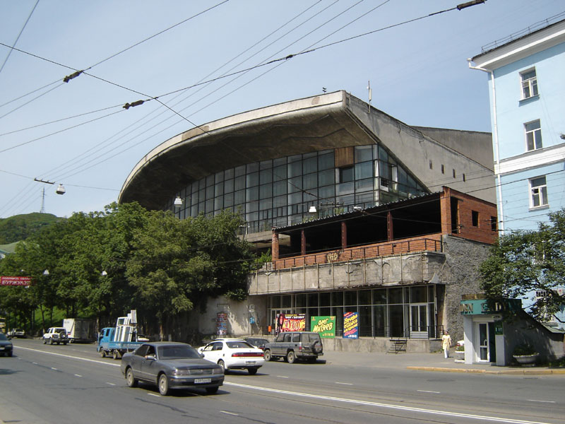

Фото: AdmiralHood. [CC BY-SA 3.0](https://creativecommons.org/licenses/by-sa/3.0). [Оригинальная страница](https://commons.wikimedia.org/wiki/File:Vladivostok_circus.jpg).

Дата снимка по источнику: Taken on 24 August 2005

### Дом-музей семьи Сухановых

ID: `guide-f05`

Деревянный особняк XIX века на улице Суханова, где сохранилась история семьи чиновника Александра Суханова. Музей помогает представить домашний быт старого Владивостока и судьбы его жителей.

Адрес: Суханова, 9.

Источник: https://old.arseniev.org/officials-house/?special_version=Y

Перед визитом: часы, билет и вход. Внешний этап квеста и музейный визит — разные действия.

Фото: LoreMasterTes. [CC BY-SA 4.0](https://creativecommons.org/licenses/by-sa/4.0). [Оригинальная страница](https://commons.wikimedia.org/wiki/File:%D0%A1%D1%83%D1%85%D0%B0%D0%BD%D0%BE%D0%B2%D0%B0_9.jpg).

Дата снимка по источнику: 2017-09-10

Фото: Кабанкова Валерия. [CC BY-SA 4.0](https://creativecommons.org/licenses/by-sa/4.0). [Оригинальная страница](https://commons.wikimedia.org/wiki/File:%D0%A1%D1%83%D1%85%D0%B0%D0%BD%D0%BE%D0%B2%D0%B0_9_%D0%94%D0%BE%D0%BC_%D0%A1%D1%83%D1%85%D0%B0%D0%BD%D0%BE%D0%B2%D1%8B%D1%85%2B.jpg).

Дата снимка по источнику: 2023-09-22

### Музей Тихоокеанского флота

ID: `guide-f06`

Музей на Светланской, 66, посвящён истории Тихоокеанского флота. Экспозиция знакомит с морской службой через документы и предметы; посещение залов планируется отдельно от наружной прогулки.

Адрес: Светланская, 66.

Источник: https://visit-primorye.ru/what-to-do/voenno-istoricheskij-muzej-tihookeanskogo-flota

Перед визитом: текущий режим, день посещения, билет и доступные экспозиции.

Фото: Vyacheslav Bukharov. [CC BY-SA 4.0](https://creativecommons.org/licenses/by-sa/4.0). [Оригинальная страница](https://commons.wikimedia.org/wiki/File:Vladivostok_Military-historical_Museum_of_the_Pacific_fleet_(October_2024)-0.jpg).

Дата снимка по источнику: 2024-10-07 17:24:33

Фото: Vyacheslav Bukharov. [CC BY-SA 4.0](https://creativecommons.org/licenses/by-sa/4.0). [Оригинальная страница](https://commons.wikimedia.org/wiki/File:Vladivostok_Military-historical_Museum_of_the_Pacific_fleet_(October_2024)-0_10.jpg).

Дата снимка по источнику: 2024-10-07 17:28:38

### С-56

ID: `guide-f07`

Подводная лодка на Корабельной набережной служит музеем и мемориальным объектом. Снаружи можно рассмотреть сам корабль, а для знакомства с внутренней экспозицией нужно отдельно уточнять условия посещения.

Адрес: Корабельная набережная, подводная лодка-музей.

Источник: https://visit-primorye.ru/what-to-do/gvardejskaya-krasnoznamennaya-podvodnaya-lodka-s-56

Перед визитом: вход, текущую работу и ограничения. Для ребёнка или человека с ограничениями подвижности особенности внутреннего прохода уточняются заранее.

Фото: Vyacheslav Bukharov. [CC BY-SA 4.0](https://creativecommons.org/licenses/by-sa/4.0). [Оригинальная страница](https://commons.wikimedia.org/wiki/File:S-56_Submarine_Monument_in_Vladivostok_(October_2024)-0_2.jpg).

Дата снимка по источнику: 2024-10-08 10:23:35

Фото: Alexxx1979. [CC BY-SA 4.0](https://creativecommons.org/licenses/by-sa/4.0). [Оригинальная страница](https://commons.wikimedia.org/wiki/File:Vladivostok_Submarine_S-56_P8050502_2200.jpg).

Дата снимка по источнику: 2015-08-05 12:17:32

### Набережная Цесаревича

ID: `guide-f08`

Прогулочное пространство у бухты Золотой Рог, открытое в 2012 году. Морские виды, Золотой мост и соседние промышленные здания создают характерный для Владивостока городской пейзаж.

Адрес: общественное пространство у Золотого Рога; точный вход выбрать при нанесении на карту.

Источник: https://visit-primorye.ru/what-to-do/naberezhnaya-cesarevicha

Перед визитом: проход, ограничения и погоду; вечернее освещение и туалет отдельно.

Фото: Artyom Svetlov. [CC BY 4.0](https://creativecommons.org/licenses/by/4.0). [Оригинальная страница](https://commons.wikimedia.org/wiki/File:Vladivostok_Naberezhnaya_Tsesarevicha_2024-09_32.jpg).

Дата снимка по источнику: Taken on 2 September 2024, 16:00:00 (according to   Exif   data)

Фото: Artyom Svetlov. [CC BY 4.0](https://creativecommons.org/licenses/by/4.0). [Оригинальная страница](https://commons.wikimedia.org/wiki/File:Vladivostok_Naberezhnaya_Tsesarevicha_2024-09_35.jpg).

Дата снимка по источнику: Taken on 2 September 2024, 16:00:00 (according to   Exif   data)

### Нагорный парк

ID: `guide-f09`

Парк на Тюменской сопке с прогулочными дорожками и видовыми площадками над городом. Открыт в 2021 году; интересен сочетанием озеленённых пространств, рельефа и панорам Золотого Рога.

Адрес: парк с входами со стороны Шилкинской и прилегающих улиц; не ставить маркер на случайную точку склона.

Источник: https://vvo.live/post/novye-dorozhki-i-tualet-s-peniem-ptic-chto-izmenilos-v-nagornom-parke

Перед визитом: границу района, актуальные входы, лестницы и отдельный путь до санитарной точки.

Фото: Artyom Svetlov. [CC BY 4.0](https://creativecommons.org/licenses/by/4.0). [Оригинальная страница](https://commons.wikimedia.org/wiki/File:Vladivostok_Nagorny_park_2024-09_033.jpg).

Дата снимка по источнику: Taken on 3 September 2024, 14:00:04 (according to   Exif   data)

Фото: A. C. Tatarinov. [CC0](http://creativecommons.org/publicdomain/zero/1.0/deed.en). [Оригинальная страница](https://commons.wikimedia.org/wiki/File:%D0%9D%D0%B0%D0%B3%D0%BE%D1%80%D0%BD%D1%8B%D0%B9_%D0%BF%D0%B0%D1%80%D0%BA._%D0%A1%D0%BE%D0%BF%D0%BA%D0%B0_%D0%91%D1%83%D1%81%D1%81%D0%B5_2.jpg).

Дата снимка по источнику: 2021-08-18 19:35:29

### Кирха Святого Павла

ID: `guide-f10`

Лютеранская кирха на Пушкинской улице, узнаваемая по кирпичным фасадам и готическому силуэту. Здесь можно познакомиться с архитектурой и религиозной историей многонационального Владивостока.

Адрес: Пушкинская, 14.

Источник: https://vladivostok-city.com/ru/places/all/all/934

Перед визитом: организатора, дату, билет и правила посещения действующего религиозного места.

Фото: Andshel. [CC BY-SA 4.0](https://creativecommons.org/licenses/by-sa/4.0). [Оригинальная страница](https://commons.wikimedia.org/wiki/File:Church_of_St._Paul_(Vladivostok)_%D1%841.JPG).

Дата снимка по источнику: 2014-07-21 06:57:11

Фото: Andshel. [CC BY-SA 4.0](https://creativecommons.org/licenses/by-sa/4.0). [Оригинальная страница](https://commons.wikimedia.org/wiki/File:Church_of_St._Paul_(Vladivostok)%D1%842.JPG).

Дата снимка по источнику: 2014-07-21 06:57:05

### Глубина

ID: `guide-h01`

Тип: капсульный хостел; общие номера и женский вариант по сайту. Кому подходит: человеку, которому достаточно места в общем номере. Общая кухня указана на сайте, но не означает питание в тарифе.

Адрес: Уборевича, 5А.

Источник: https://glubina-vl.ru/

Перед визитом: район, цену конкретной капсулы, условия заезда и позднего прибытия, актуальное наличие.

Цены (ранее собранный ориентир, не подтверждён заново): от 1 500 ₽ в сутки **за место**, не за отдельный номер. Нужные даты не проверялись.

Фото: подходящий файл со свободной лицензией пока не включён.

### Корона на Адмирала Кузнецова

ID: `guide-h02`

Тип: хостел; не путать с одноимённым отелем на Верхнепортовой и гостевым домом на Крыгина. Кому подходит: кандидат для бюджетного ночлега в общей комнате. Комнату, пол гостей и условия заселения нужно выбирать отдельно.

Адрес: Адмирала Кузнецова, 68.

Источник: https://www.vl.ru/vldk-korona

Перед визитом: действующий тариф, доступные места, условия кухни и регистрации.

Цены (ранее собранный ориентир, не подтверждён заново): подтверждённой цены на даты нет. VL.ru указывает 600–850 ₽ за койко-место в сутки, а сайт объекта публикует другие нижние тарифы. Несогласованные данные не переносим в поле текущей цены.

Фото: подходящий файл со свободной лицензией пока не включён.

### Феникс

ID: `guide-h03`

Тип: хостел; разные варианты размещения. Кому подходит: кандидат для ночлега в районе Юмашева, в том числе для двоих при наличии отдельной комнаты.

Адрес: Адмирала Юмашева, 25.

Источник: https://vvo.live/post/ekonomnyj-vladivostok-gde-poluchit-maksimum-vpechatlenij-za-minimum-deneg

Перед визитом: тариф на даты, свободные комнаты и позднее заселение. Не обещать цену из сезонного обзора.

Цены (ранее собранный ориентир, не подтверждён заново): только справочный пример — в летней публикации 2026 года приведены 3 000 ₽ за двухместный номер в сутки без завтрака. Это не цена койко-места и не предложение на сегодняшнюю ночь.

Фото: подходящий файл со свободной лицензией пока не включён.

### Хостел на Ивановской

ID: `guide-h04`

Тип: хостел; в карточке есть кровать в общем восьмиместном номере. Кому подходит: кандидат для одного путешественника, готового к общей комнате.

Адрес: Новоивановская, 12. Название объекта не заменяет фактический адрес.

Источник: https://travel.yandex.ru/hotels/vladivostok/khostel-na-ivanovskoi/

Перед визитом: актуальное название, район, наличие нужного типа места, заезд и документы. Рейтинг не используем как доказательство безопасности.

Цены (ранее собранный ориентир, не подтверждён заново): не уточнена — сервис предлагает выбрать даты. Не переносим рекламную минимальную цену из общего списка как гарантированную.

Фото: подходящий файл со свободной лицензией пока не включён.

### Capsule Hotel Group

ID: `guide-h05`

Тип: капсульный отель. Кому подходит: дополнительный кандидат для восточной части района.

Адрес: Светланская, 197.

Источник: https://vladivostok.jsprav.ru/ekonom-gostinitsyi-i-oteli/capsule-hotel/

Перед визитом: существование объекта сейчас, точный вход и действующие контакты. В карточке указано ограниченное дневное окно работы, поэтому поздний заезд без подтверждения не обещаем.

Цены (ранее собранный ориентир, не подтверждён заново): не найдена в выбранной карточке; уточнить напрямую.

Фото: подходящий файл со свободной лицензией пока не включён.

### ЛОТТЕ Отель Владивосток

ID: `guide-h06`

Тип: гостиница с отдельными номерами; вариант более высокого бюджета. Кому подходит: тем, кому нужен отдельный номер и гостиничный сервис, а не бюджетное койко-место.

Адрес: Семёновская, 29.

Источник: https://lottehotelvladivostok.ru/

Перед визитом: районную границу, итоговую цену, включённое питание и правила выбранного тарифа.

Цены (ранее собранный ориентир, не подтверждён заново): определяется по датам и категории на сайте; фиксированный тариф не найден и не выдумывается.

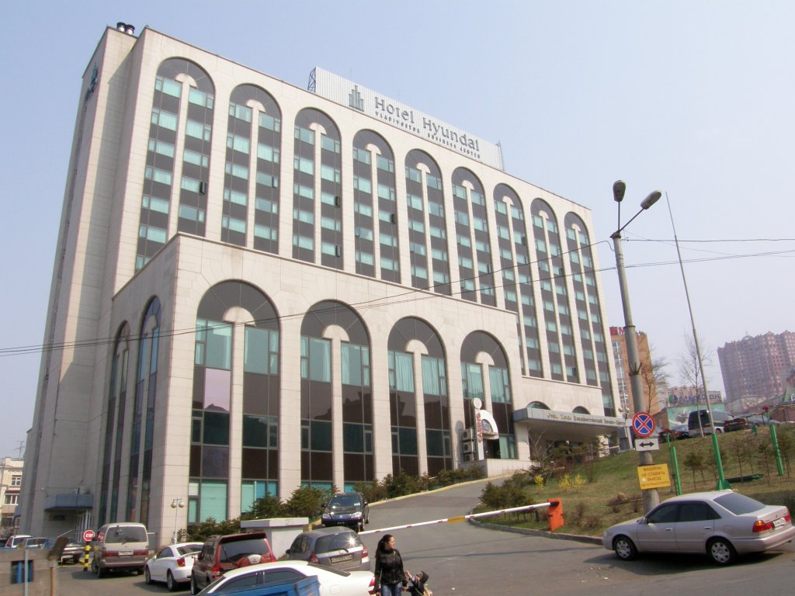

Фото: Jack Shadow  from Vladivostok, Russian Federation. [CC BY 2.0](https://creativecommons.org/licenses/by/2.0). [Оригинальная страница](https://commons.wikimedia.org/wiki/File:Hyundai_hotel.jpg).

Дата снимка по источнику: Taken on 17 April 2008, 12:07

Архивный вид здания 2008 года с прежней вывеской Hyundai. Не использовать как современное фото LOTTE.
[Сопоставление здания](https://primamedia.ru/news/665503/)

### Аванта

ID: `guide-h07`

Тип: гостиница. Кому подходит: отдельный вариант размещения в районе Гоголя; не обозначать как соседнюю остановку морской прогулки.

Адрес: Гоголя, 41, строение 3.

Источник: https://hotel-avanta.ru/

Перед визитом: границу района, путь к входу и ограничения территории. Сайт отдельно описывает проход и автомобильный въезд; не строить путь к произвольному входу университета.

Цены (ранее собранный ориентир, не подтверждён заново): по датам и категории; текущая сумма не подтверждена.

Фото: подходящий файл со свободной лицензией пока не включён.

### Астория

ID: `guide-h08`

Тип: гостиница. Кому подходит: кандидат для отдельного номера в другой части подборки, а не рядом с каждой точкой центра.

Адрес: Партизанский проспект, 44, корпус 6.

Источник: https://astoria.iprim.ru/

Перед визитом: район, действующий тариф, корпус и доступ к входу, условия позднего заезда.

Цены (ранее собранный ориентир, не подтверждён заново): не уточнена на даты. Старые конференционные тарифы не используются как актуальный прайс.

Фото: подходящий файл со свободной лицензией пока не включён.

### Адмиральский сквер

ID: `guide-t01`

Сведения: объект указан в перечне муниципальных общественных туалетов, опубликованном 29 июня 2026 года со ссылкой на МКУ «Зелёный Владивосток». Стоимость и часы конкретно этой точки: из выбранного сообщения не установлены. Указанные там бесплатность и 08:00–20:00 относятся к туалету на набережной Арсеньева, не переносим их на весь список.

Адрес: Светланская, 48, Адмиральский сквер.

Источник: https://prim.news/2026/06/29/vo-vladivostoke-na-naberezhnoj-arseneva-zarabotal-obshhestvennyj-tualet/

Перед визитом: координаты входа, работу сегодня, тариф и график.

Фото: подходящий файл со свободной лицензией пока не включён.

### Подземный переход у Светланской, 29

ID: `guide-t02`

Сведения: точка включена в тот же муниципальный перечень.

Адрес: переход около Светланской, 29; точный вход требуется отметить отдельно.

Источник: https://prim.news/2026/06/29/vo-vladivostoke-na-naberezhnoj-arseneva-zarabotal-obshhestvennyj-tualet/

Перед визитом: границу района, лестницы, конкретный вход и фактическую работу.

Цены (ранее собранный ориентир, не подтверждён заново): не подтверждены для этой точки. Не обещаем круглосуточность и бесплатность.

Фото: подходящий файл со свободной лицензией пока не включён.

### Набережная Цесаревича

ID: `guide-t03`

Последние найденные подробные сведения: в обзоре от 20 августа 2026 — 60 ₽, ежедневно 11:00–23:00. Критическая оговорка: обновление того же материала сообщает о повторном закрытии. Сегодняшняя работа не подтверждена; цифры остаются исторической справкой, не текущим обещанием. Как показывать: только со статусом «уточнить работу», не как гарантированно открытый ближайший туалет.

Адрес: отдельное здание у детской площадки-корабля и «Кровати примирения».

Источник: https://www.newsvl.ru/vlad/2026/08/20/239924/

Перед визитом: 

Фото: подходящий файл со свободной лицензией пока не включён.

### Нагорный парк

ID: `guide-t04`

Сведения: публикация от 9 июня 2026 года сообщает о появлении этой точки.

Адрес: туалет возле кёрлинг-центра; не путать с другими санитарными объектами парка.

Источник: https://vvo.live/post/novye-dorozhki-i-tualet-s-peniem-ptic-chto-izmenilos-v-nagornom-parke

Перед визитом: конкретное здание, вход, границу района и статус работы; переход от основных прогулок может требовать отдельного пути.

Цены (ранее собранный ориентир, не подтверждён заново): не уточнены в выбранном источнике.

Фото: подходящий файл со свободной лицензией пока не включён.

### Лазо, 26, строение 2

ID: `guide-t05`

Сведения: в каталоге отмечен бесплатный общественный туалет. Стоимость: «бесплатно» — только характеристика справочника; не подтверждена на месте. Режим неизвестен.

Адрес: Лазо, 26, строение 2.

Источник: https://totadres.ru/vladivostok/obschestvennye_tualety/p/1

Перед визитом: существование, точное положение, вход, район и стоимость сегодня. Источник вторичный, поэтому это резерв для проверки, не готовая срочная рекомендация.

Фото: подходящий файл со свободной лицензией пока не включён.
