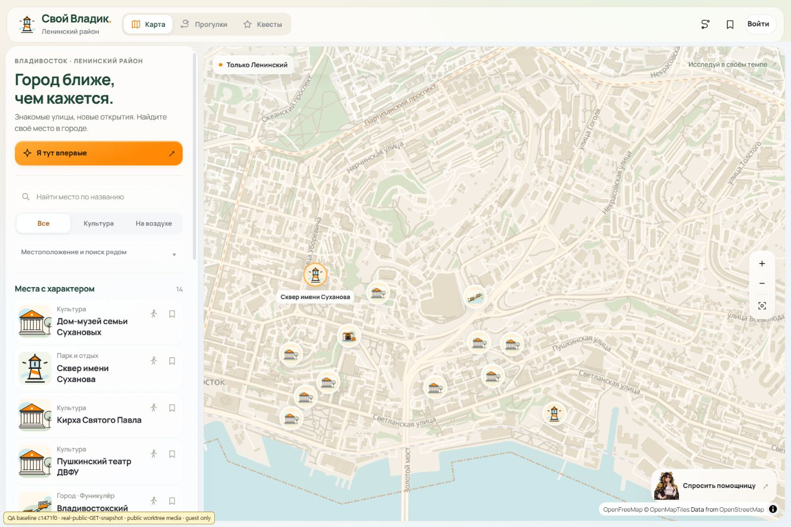
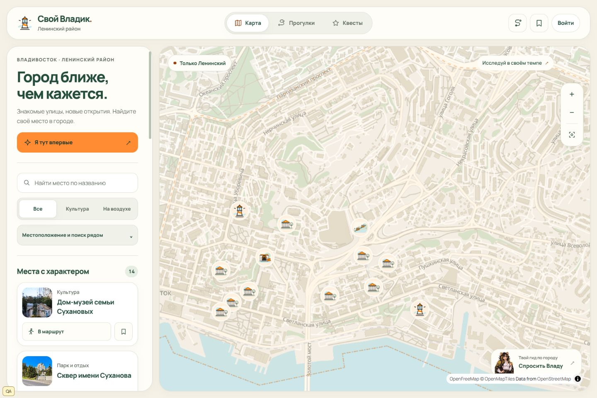

# Задача 022: редизайн интерфейса

Ветка `frontend/task-022-redesign`, PR в `main`. Исходный UI для сравнения —
`c1471f0`; база PR обновлена до `fc85d2a`. Два новых коммита main затрагивают
документацию и запуск тестов, исходный UI остался тем же.

## Изменения

- Общие токены cream/paper, forest/ink, orange, mint/sea, шкала текста,
  отступы, радиусы, тени и длительности. `styles.css` загружается после
  прежних glass/polish и последовательно управляет оформлением.
- Карта занимает 1040 px из 1408 px рабочей области на экране 1440 px и
  1488 px из 1888 px на 1920 px. Панель прокручивается независимо от шапки.
- Навигация и инструменты получили единые пилюли. Аватар и логин остаются
  на одной строке, длинный логин сокращается. Для 768 px исправлен наезд
  инструментов на навигацию при максимальном логине.
- Карточки используют проверенные URL существующих фотографий. При ошибке
  остаётся исходная SVG-иллюстрация. Маршрут и сохранение вынесены в отдельную
  строку с целями нажатия 44 px; доступные подписи включают название места.
- Диалоги прокручивают `*-content`, а кнопка закрытия остаётся вне прокрутки.
  Фокус возвращается к вызвавшей кнопке после Escape.
- Профиль, галерея, маршрут, гид и Влада оформлены общими компонентами.
  Встроенная подсказка Влады визуально тише основного содержимого.
- Прогресс обхода оставляет место зуму, атрибуции, нижней навигации и листу.
  Камера выбирает свободное положение для значка выбранной точки с учётом
  настоящих размеров панелей и подписи. Без свободной области сохраняется
  прежнее центрирование. На телефоне во время обхода название показано в
  прогрессе, на карте остаётся доступный именованный значок с номером.

Стиль `map-style.json`, данные, API, backend, Docker и CI не менялись.
Существующие проверки сохранены, новых библиотек нет.

## DOM и совместимость

Имена существующих id и обработчики событий сохранены. В карточке добавлены
`.place-card-visual` и `.place-card-actions`; маршрут получил
`.place-action-label`, изображения — `.is-photo`/`.is-illustration`.
У `#guide-open` добавлена структурированная подпись `.guide-button-copy`.
Содержимое диалогов по-прежнему находится в исходных `*-content`.

Логика auth/аватаров, GPS, маршрутов, Влады, галереи и инициализации MapLibre
проверена точным сравнением с исходной базой. Менялось представление карточек
и позиционирование камеры при выборе публичного места.

## Проверки

| Команда | Результат |
|---|---|
| `node --check frontend-design/dist/app.js` | PASS, exit 0 |
| `node --test frontend-design/tests/` | 67 passed, 0 failed |
| `node scripts/build.mjs` | PASS, manifest пересчитан, 33 публичных файла |
| `node scripts/build.mjs --check-only` | PASS, файлы не изменены |
| `git diff --check` | PASS |

Пять новых тестов камеры проверяют свободную область на телефоне, центр
большой карты, перекрытый экран, скрытые панели и смещение длинной подписи
у маркера с нижним якорем. Прежние 62 теста сохранены.

Основные пары контраста: forest/paper 9.50:1, muted/paper 5.26:1,
muted/surface-soft 4.71:1, muted/mint 4.51:1, ink/orange 5.33:1.
Сохранены `prefers-reduced-motion`, aria-live, aria-pressed и видимый фокус.

Браузер: CSS viewport 390×844, 768×1024, 1440×960 и 1920×1080.
Мобильный захват сохраняет растр 390×843 из-за округления инструмента;
раскладка проверялась при `innerHeight=844`.

- Горизонтальной прокрутки нет. Проверены длинный логин, длинные названия,
  внутренний scroll, Escape и клавиатурный переход к действиям карточки.
- Галерея переключается с 1/2 на 2/2, подписи и источники сохранены.
- Две точки личного маршрута переставлены; порядок восстановился после reload.
- Прогулка пройдена тремя честными отметками без GPS и завершена. Проверены
  открытый/свёрнутый лист и отсутствие наезда прогресса на управление картой.
- В учебном просмотре квеста нет вопросов или зачёта. При открытом списке
  отсутствуют повторные кнопки «Открыть квесты/прогулки».
- Синтетический профиль: шесть аватаров, три закрыты. Выбор доступного аватара
  обновляет изображение рядом с логином; текст остаётся на одной строке.

## Данные проверки и ограничения

Изолированный frontend-only QA вне репозитория отдаёт исходный UI на 5192,
новый гостевой на 5193 и новый с синтетическим профилем на 5194. Каталог —
неизменяемый снимок настоящих публичных GET API
`https://176-53-253-60.sslip.io/`: 14 мест с images, 4 прогулки, 4 квеста.
Для одинакового сравнения используются публичные байты фото из worktree.
Доставка `/media` действующим сервером отдельно не проверялась.

Профиль и 32-символьный QA-логин синтетические. Реальные аккаунты,
регистрация, вход, лайки и посещения на сервере не менялись. QA не пересылает
Cookie/Authorization и запросы записи. Реальный GPS не запрашивался;
приватность координат/точности/времени проверяется существующими тестами.

Не проверены физический телефон, настоящий тач/GPS, живой переход во внешнее
приложение 2ГИС, запись в настоящий аккаунт и Safari. Полное прохождение
итогового опроса с серверными ответами не входит в этот визуальный прогон.
Системную настройку reduced-motion не переключали; её код покрыт тестами.

## Сравнение и скриншоты

До:

После:

| Экран | Главный | Место | Профиль |
|---|---|---|---|
| Телефон | [390](task-022-after-mobile.jpg) | [Карточка](task-022-place-mobile.jpg) | [Профиль](task-022-profile-mobile.jpg) |
| Планшет | [768](task-022-after-tablet.jpg) | [Карточка](task-022-place-tablet.jpg) | [Профиль](task-022-profile-tablet.jpg) |
| ПК | [1440](task-022-after-desktop.jpg) | [Карточка](task-022-place-desktop.jpg) | [Профиль](task-022-profile-desktop.jpg) |

Дополнительно: [1920](task-022-after-wide.jpg),
[исходный телефон](task-022-before-mobile.jpg),
[нижний лист и фокус](task-022-mobile-sheet.jpg),
[маршрут](task-022-route-mobile.jpg),
[обход](task-022-journey-mobile.jpg), [Влада](task-022-vlada-mobile.jpg).
